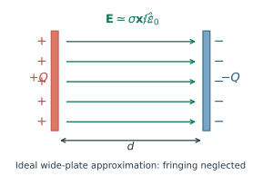

# Chapter 4 — Conductors and Capacitance

In a conductor, some charges are free to rearrange. Their movement changes the field until electrostatic equilibrium is reached. This simple condition explains the properties of conducting surfaces and, when combined with potential, leads naturally to capacitance and field energy.

## 4.1 Electrostatic equilibrium

If a static electric field persisted inside a conducting material, mobile carriers would continue to move. At equilibrium their redistribution has cancelled the field in the bulk:

$$\boxed{\mathbf E_{\rm metal}=0}\quad\Rightarrow\quad\nabla\phi=0\quad\Rightarrow\quad\boxed{\phi=\text{constant on each connected conductor}}.$$

Gauss's law then gives $\rho_{\rm bulk}=0$ for *excess* electrostatic charge in the metal; the material still contains microscopic positive and negative charges. Excess charge resides on its surfaces. The surface charge density $\sigma$ is measured in $\mathrm{C/m^2}$. At a surface the tangential field must vanish, otherwise charges would move along it. Just outside a conductor in vacuum, (by constructing a very thin Gaussian pillbox on the conductor's surface)

$$\varepsilon_0(E_{n,\rm out}-E_{n,\rm in})=\sigma\quad\Rightarrow\quad\boxed{\mathbf E_{\rm out}=\frac\sigma{\varepsilon_0}\hat{\mathbf n}}.$$

This is the local field at the surface of a conductor, not the field of an isolated nonconducting infinite sheet ($\sigma/2\varepsilon_0$ on each side).

## 4.2 Cavities and shielding

Consider an empty cavity completely enclosed by a conductor at electrostatic equilibrium. Its boundary is an equipotential, and the charge-free cavity solves Laplace's equation with a constant boundary value. The only solution is constant potential, so the cavity field is zero. External static charges therefore cannot produce a field inside a completely closed empty cavity.

If a charge $q$ sits in the cavity, choose a Gaussian surface entirely within the surrounding metal. Since $\mathbf E=0$ on that surface, it encloses zero net charge: the total induced charge on the inner wall is $-q$. If the conductor was initially neutral and isolated, its outer surface must then carry $+q$. These are statements about total charges; finding their detailed distributions generally requires solving a boundary-value problem.

## 4.3 Why boundary conditions matter: uniqueness

Poisson's equation by itself is not enough; multiple solutions can differ by a solution of Laplace's equation. Suppose $\phi_1$ and $\phi_2$ solve the *same* Poisson equation and have the *same potential on the boundary*. Their difference $u=\phi_1-\phi_2$ satisfies $\nabla^2u=0$ and $u=0$ at the boundary.

Use the identity $\nabla\cdot(u\nabla u)=|\nabla u|^2+u\nabla^2u$ and integrate:

$$\int_V|\nabla u|^2dV=\oint_{\partial V}u\nabla u\cdot d\mathbf S-\int_Vu\nabla^2u\,dV=0.$$

The nonnegative integrand must vanish, so $\nabla u=0$ everywhere in a connected region. The boundary condition sets the remaining constant to zero: $\phi_1=\phi_2$. This **uniqueness theorem** explains why any mathematical construction satisfying both the equation and the required boundary potentials gives the physical answer.

## 4.4 Method of images

Place a point charge $q$ at $(0,0,a)$ above an infinite grounded conductor occupying $z\le0$. The unknown induced surface charge makes direct integration awkward. Replace the conductor *mathematically*, in the physical region $z>0$ only, with a fictitious image charge $-q$ at $(0,0,-a)$:

$$\phi(x,y,z)=\frac q{4\pi\varepsilon_0}\left(\frac1{\sqrt{x^2+y^2+(z-a)^2}}-\frac1{\sqrt{x^2+y^2+(z+a)^2}}\right).$$

This expression obeys Poisson's equation for the real charge in $z>0$ and gives $\phi=0$ on the plane. By uniqueness, the resulting field above the conductor is correct. The image charge does not physically exist, and the formula is *not* the field inside the actual conducting material.

The surface charge follows from the normal electric field just outside it:

$$\sigma(x,y)=\varepsilon_0E_z(0^+)=-\frac{qa}{2\pi(x^2+y^2+a^2)^{3/2}},\qquad\int\sigma\,dS=-q.$$

## 4.5 Capacitance from potential difference

Two conductors with charges $+Q$ and $-Q$ (coulombs, $\mathrm C$) generally have a potential difference $\Delta V$ (volts, $\mathrm V$). In a linear dielectric or vacuum the electric field and potential scale with $Q$, so their ratio is a geometric/material property:

$$\boxed{C=\frac{Q}{\Delta V}}\qquad[C]=\mathrm F=\mathrm{C/V}.$$

For parallel plates of area $A$ ($\mathrm{m^2}$) separated by distance $d$ ($\mathrm m$), neglect edge fields. The field between them is approximately $E=Q/(\varepsilon_0A)$ and $\Delta V=Ed$; therefore

$$\boxed{C_{\rm plates}\simeq\frac{\varepsilon_0A}{d}}.$$

*Figure 4.1.* The arrows show the approximate **uniform field between wide plates**; the diagram intentionally omits edge fringing.

For concentric spherical conducting shells with radii $a<b$ (metres), apply Gauss's law between them and integrate $E\,dr$ ($a<r<b$):

$$ E(\mathbf r) \cdot 4\pi r^2 = \frac{Q}{\varepsilon_0} \quad\Rightarrow\quad\ E(\mathbf r)=\frac{Q}{4\pi\varepsilon_0r^2}$$

$$\Delta V=\int_{a}^{b}E(\mathbf r) d\mathbf r=\frac Q{4\pi\varepsilon_0}\left(\frac1a-\frac1b\right)\quad\Rightarrow\quad\boxed{C_{\rm spheres}=\frac{Q}{\Delta V}=4\pi\varepsilon_0\frac{ab}{b-a}}.$$

For long coaxial cylinders with radii $a<b$ and length $L$ (metres), neglect ends:

$$E(r)=\frac{Q}{2\pi\varepsilon_0Lr},\qquad \Delta V=\int_{a}^{b}E(\mathbf r) d\mathbf r=\frac Q{2\pi\varepsilon_0L}\ln\frac ba,\qquad\boxed{C_{\rm coax}=\frac{Q}{\Delta V}=\frac{2\pi\varepsilon_0L}{\ln(b/a)}}.$$

All three are consequences of the same definition; only the field geometry changes.

## 4.6 Connections of capacitors

For capacitors in parallel, both plates of each element share the same two potentials. Their charges add while $\Delta V$ is common, hence $C_{\rm eq}=\sum_iC_i$. In series, isolated intermediate nodes carry equal and opposite charges: each element stores the same magnitude $Q$, but the voltage differences add, hence

$$\boxed{C_{\rm parallel}=\sum_i C_i},\qquad\boxed{\frac1{C_{\rm series}}=\sum_i\frac1{C_i}}.$$

## 4.7 Work required to charge a capacitor

When a capacitor already holds charge $q$, its voltage is $V(q)=q/C$. Adding a further charge $dq$ requires work $dW=V(q)\,dq$. For constant $C$,

$$U=\int_0^Q\frac qC\,dq=\boxed{\frac{Q^2}{2C}=\frac12Q\Delta V=\frac12C(\Delta V)^2}.$$

For parallel plates of area $A$ and separation $d$, Gauss's law gives $E=Q/(\varepsilon_0A)$ and $C=\varepsilon_0A/d$. Substituting into the stored energy,

$$
U=\frac{Q^2}{2C}
=\frac{Q^2d}{2\varepsilon_0A}
=\frac12\varepsilon_0E^2(Ad),
$$

consistent with the field-energy density $u=\frac12\varepsilon_0E^2$ derived in Chapter 3.

When the plate separation changes, the external work depends on the **total energy change**. For an isolated capacitor, $Q$ is constant, so $dW_{\mathrm{ext}}=dU_{\mathrm{cap}}$. At fixed voltage, however, the battery maintains $V$ by exchanging charge $dQ=V\,dC$. The capacitor energy changes by $dU_{\mathrm{cap}}=\frac12V^2dC$, while the battery energy changes by $dU_{\mathrm{battery}}=-V\,dQ=-V^2dC$. Therefore,

$$
dW_{\mathrm{ext}}
=dU_{\mathrm{cap}}+dU_{\mathrm{battery}}
=-\frac12V^2dC.
$$

When the plates are pulled apart, $dC<0$, so the external work is positive in both cases. Differentiating $\frac12CV^2$ alone at fixed $V$ misses the energy exchanged with the battery.

The local electrostatic pressure $p$ (pascals, $\mathrm{Pa}=\mathrm{N/m^2}$) on a conductor surface can also be obtained from the force on its surface charge. Since a charge element cannot exert a force on itself, we use the field produced by the **remaining charges**. For a conductor in vacuum, the field immediately outside is $E=\sigma/\varepsilon_0$, while the effective field acting on a small surface element is $E_{\mathrm{other}}=E/2=\sigma/(2\varepsilon_0)$. (
A small surface element produces fields $\pm\sigma/(2\varepsilon_0)$ on its two sides; since the total field inside the conductor is zero, the field produced by all **other charges** must cancel the element's inward field, giving $E_{\mathrm{other}}=\sigma/(2\varepsilon_0)$, while outside the two fields add to give $E_{\mathrm{out}}=\sigma/\varepsilon_0$, hence $\boxed{E_{\mathrm{other}}=E_{\mathrm{out}}/2}$.
) Thus,

$$
p=\frac{dF}{dA}
=\sigma E_{\mathrm{other}}
=\boxed{\frac{\sigma^2}{2\varepsilon_0}
=\frac12\varepsilon_0E^2}.
$$

The factor $1/2$ appears because the surface charge must not be counted as exerting a force on itself.

## 4.8 Changing the Plate Separation

Consider a charged parallel-plate capacitor with plate area $A$ and separation $d$, neglecting edge effects. Its capacitance is

$$
C=\frac{\varepsilon_0 A}{d}.
$$

Increasing $d$ always decreases $C$, but the response of the electric field and stored energy depends on whether the capacitor remains connected to a battery.

### 4.8.1 Isolated capacitor — fixed charge

After charging, disconnect the battery. There is no path for charge to leave the plates, so $Q$ remains constant.

From Gauss's law,

$$
E=\frac{Q}{\varepsilon_0 A}.
$$

Since neither $Q$ nor $A$ changes, the electric field remains constant as the plates are separated.

However, the potential difference is

$$
V=Ed=\frac{Qd}{\varepsilon_0 A}.
$$

Thus increasing $d$ increases $V$, even though the electric field does not change.

The stored energy is

$$
U=\frac{Q^2}{2C}
=\frac{Q^2d}{2\varepsilon_0 A}.
$$

To separate the plates slowly by $dd$, the external force must supply the increase in energy:

$$
dW_{\mathrm{ext}}=dU=F_{\mathrm{ext}}\,dd.
$$

Therefore,

$$
\boxed{
F_{\mathrm{ext}}=
\frac{dU}{dd}
=\frac{Q^2}{2\varepsilon_0 A}
}.
$$

The force needed to separate the plates is constant in the ideal parallel-plate approximation. The electrical force is attractive and acts in the opposite direction.

### 4.8.2 Battery-connected capacitor — fixed voltage

Now keep the capacitor connected to an ideal battery. The battery maintains a constant potential difference $V$.

Since

$$
E=\frac{V}{d},
$$

increasing $d$ decreases the electric field.

The capacitance also decreases, so

$$
Q=CV=\frac{\varepsilon_0 AV}{d}
$$

decreases. Charge flows back into the battery.

The energy stored in the capacitor is

$$
U_{\mathrm{cap}}=\frac12CV^2
=\frac{\varepsilon_0 AV^2}{2d}.
$$

Unlike the isolated case, this is not the total energy of the system. As charge returns to the battery, the battery gains energy.

For a small change in capacitance,

$$
dU_{\mathrm{cap}}=\frac12V^2\,dC,
$$

while the energy gained by the battery is

$$
dU_{\mathrm{battery}}=-V\,dQ=-V^2\,dC,
$$

because $V$ is constant and $dQ=V\,dC$. Here, you might be wondering why there is a negative sign, this is because $dQ$ represents the charge change in the capacitor, the energy supplied by the battery to the capacitor is $VdQ$, so the energy that the battery gains is $-VdQ$.

The external work therefore satisfies

$$
dW_{\mathrm{ext}}
=dU_{\mathrm{cap}}+dU_{\mathrm{battery}}
=-\frac12V^2\,dC.
$$

Using $C=\varepsilon_0A/d$,

$$
\boxed{
F_{\mathrm{ext}}
=\frac{\varepsilon_0 AV^2}{2d^2}
}.
$$

The plates still attract each other, but the attractive force decreases as their separation increases.

### 4.8.3 Physical interpretation

The difference comes entirely from the constraint imposed on the system.

With the battery disconnected, charge cannot escape, so it remains constant. The field remains constant, so increasing the distance increases the potential difference and the field energy.

With the battery connected, the battery holds the voltage constant. Increasing the distance weakens the field and sends charge back to the battery. The capacitor loses energy, but the battery gains more energy than the capacitor loses; the difference is the external work needed to separate the plates.

If the plates initially carry no charge and no voltage is applied, this ideal electrostatic model gives no attractive electrical force.

The results assume wide parallel plates with negligible edge effects; for finite plates, the force and field also depend on fringing.

---
**Reference.** R. Shankar, *Fundamentals of Physics II: Electromagnetism, Optics, and Quantum Mechanics*, §4.5 and Chapter 6 (especially §6.4); David Halliday, Robert Resnick and Jearl Walker, *Fundamentals of Physics*, 12th ed., Chapters 23–25; David J. Griffiths, *Introduction to Electrodynamics*, 5th ed., Chapters 2–3 (uniqueness and images).
