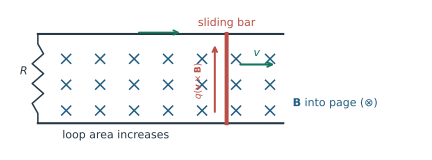

# Chapter 9 — Electromagnetic Induction and Inductance

So far we have mainly used steady sources. Faraday found that moving a magnet near a conducting loop, or changing the current in a neighbouring coil, produces a current *without a battery*. The essential question is what force drives the charges around the loop when the magnetic conditions change.

## 9.1 Flux through a loop

For a surface $S$ bounded by a closed curve $C$, define magnetic flux $\Phi_B$ (webers, $1\,\mathrm{Wb}=1\,\mathrm{T\,m^2}$):

$$\boxed{\Phi_B=\int_S\mathbf B\cdot d\mathbf S}.$$

The orientation of $C$ and its surface normal follow the right-hand rule. Since $\nabla\cdot\mathbf B=0$, different surfaces spanning the **same oriented boundary** have the same flux. When the contour moves, distinguish changes of field from changes of the surface it encloses.

## 9.2 Faraday's experiment and induced electric fields

**Observation:** a stationary conducting loop responds when the magnetic flux through it changes. The sign reverses when the magnet moves in the opposite direction; the emf vanishes again when conditions become steady.

For a **fixed** loop $C$, the induced electromotive force $\mathcal E$ (volts) is work per unit charge around the loop, $\mathcal E=\oint_C\mathbf E\cdot d\boldsymbol\ell$. Experiment gives

$$\boxed{\oint_C\mathbf E\cdot d\boldsymbol\ell=-\frac d{dt}\int_S\mathbf B\cdot d\mathbf S}.$$

Because $S$ is fixed, $d/dt$ passes through the surface integral. Stokes' theorem then converts the loop law into a local law:

$$\int_S(\nabla\times\mathbf E)\cdot d\mathbf S=-\int_S\frac{\partial\mathbf B}{\partial t}\cdot d\mathbf S$$

$$\boxed{\nabla\times\mathbf E=-\frac{\partial\mathbf B}{\partial t}}.$$

The electrostatic result $\nabla\times\mathbf E=0$ was not wrong; it belonged to *time-independent magnetic fields*. A changing magnetic field produces a circulating, non-conservative electric field.

## 9.3 Why Lenz's sign is negative

The minus sign states that the induced effect opposes the **change in flux**, not necessarily the original magnetic field. If more flux into the page enters a loop, the induced current creates a field out of the page. Otherwise the induced current would reinforce the increase, creating energy from nothing instead of requiring the external agent to supply work.

The negative sign is expressed relative to the chosen loop orientation. Once that orientation is fixed, signed flux and emf remove the need for memorising separate direction rules.

## 9.4 A moving conductor: motional emf

A conductor moving at local velocity $\mathbf u$ ($\mathrm{m/s}$) through $\mathbf B$ carries its charge carriers with it. In the laboratory frame their Lorentz force per unit charge is $\mathbf E+\mathbf u\times\mathbf B$ (ignoring small drift-dependent details in the emf bookkeeping). For a *moving material loop* $C(t)$,

$$\boxed{\mathcal E=\oint_{C(t)}(\mathbf E+\mathbf u\times\mathbf B)\cdot d\boldsymbol\ell}.$$

Consider a straight bar of length $\ell$ (metres) moving right with speed $v$ ($\mathrm{m/s}$) on conducting rails, in a uniform field $\mathbf B$ into the page. Positive charges are driven upward by $\mathbf v\times\mathbf B$, giving a motional emf of magnitude $B\ell v$ along the bar.

*Figure 9.1.* Bar moves to the right; $\mathbf B$ points into the page, so $\mathbf v\times\mathbf B$ points up the bar. The loop area grows at $dA/dt=\ell v$.

## 9.5 Unifying changing fields and moving loops

The flux through the rails-and-bar loop grows at rate $d\Phi_B/dt=B\ell v$ with the normal chosen into the page. The circulating emf is opposite that chosen orientation, so $\mathcal E=-d\Phi_B/dt$. More generally the **flux rule**

$$\boxed{\mathcal E=-\frac{d\Phi_B}{dt}}$$

holds for an ordinary smoothly moving/deforming material circuit, when its motion is included in the *total* flux derivative and the emf includes both terms in $\mathbf E+\mathbf u\times\mathbf B$. For a stationary circuit the motion term vanishes. Be careful with a contour that is not attached to material, with changing circuit topology, or with a moving contact: the line-integral definition is more fundamental than blindly applying a flux mnemonic.

For a coil of $N$ turns and area $A$ rotating with angular speed $\omega$ ($\mathrm{rad/s}$) in a uniform static field, the flux **through one turn** is $\Phi_B^{(1)}=BA\cos(\omega t)$. The linkage of all turns is $N\Phi_B^{(1)}$, so Faraday's law gives

$$\mathcal E=-\frac{d}{dt}(N\Phi_B^{(1)})=\boxed{NBA\omega\sin(\omega t)}.$$

This elementary alternating-current generator works by moving conductors through magnetic flux; eddy currents occur when induction drives closed currents inside a bulk conductor. In either case a changing flux alone does not specify the current until the circuit resistance and geometry are included.

## 9.6 Self-inductance

### Flux linkage and self-inductance

A current produces a magnetic field, part of which passes 
through the coil itself. For a coil consisting of $N$ turns, 
each turn contributes an induced emf according to Faraday's law:

$$
\mathcal E_i=-\frac{d\Phi_i}{dt}.
$$

Since the turns are connected in series, their induced emfs 
add together:

$$
\mathcal E=-\sum_{i=1}^N\frac{d\Phi_i}{dt}
=-\frac{d}{dt}\left(\sum_{i=1}^N\Phi_i\right).
$$

This motivates the definition of **flux linkage**:

$$\boxed{\lambda=\sum_{i=1}^N\Phi_i}.$$

If every turn links the same magnetic flux, then

$$\lambda=N\Phi_B.$$

Flux linkage is not a new magnetic field or the flux through 
a single surface. It accounts for the total flux linked by 
all turns, since each turn contributes to the induced emf.

From the Biot–Savart law in vacuum,

$$
\mathbf B(\mathbf r)
=I\left(
\frac{\mu_0}{4\pi}
\oint_C\frac{d\mathbf l'\times\hat{\mathbf R}}{R^2}
\right).
$$

For a fixed geometry, the expression inside the brackets 
is independent of $I$. Therefore,

$$\mathbf B\propto I,\qquad
\Phi_B\propto I,\qquad
\lambda\propto I.$$

The same proportionality holds for fixed geometries containing 
linear magnetic materials with no permanent magnetisation.

We therefore introduce the **self-inductance** $L$:

$$\boxed{\lambda=LI}.$$

For equal flux through each turn,

$$\boxed{L=\frac{N\Phi_B}{I}},
\qquad
[L]=\mathrm H=\mathrm{V\,s/A}.$$

Self-inductance describes how much flux linkage a current 
produces in its own coil. For a fixed linear system, $L$ 
depends on the geometry and magnetic properties of the 
system rather than the magnitude of the current.

### Self-induced emf

Changing the current changes the coil's own magnetic field 
and hence its flux linkage. By Faraday's law,

$$
\mathcal E_{\rm self}
=-\frac{d\lambda}{dt}
=-\frac{d(LI)}{dt}.
$$

For constant $L$,

$$\boxed{\mathcal E_{\rm self}=-L\frac{dI}{dt}}.$$

The physical mechanism is a feedback process:

1. A changing current produces a changing magnetic field.
2. The changing magnetic field generates an induced electric 
   field and hence a self-induced emf.
3. The induced electric field acts on the charges in the 
   conductor, opposing the change in current.

It is the induced electric field, rather than the magnetic 
force itself, that does work on the moving charges.

When the current increases, the induced emf opposes the 
current and is often called a **back emf**. When the current 
decreases, the induced emf acts in the direction of the 
original current, tending to maintain it.

Thus, self-induction opposes changes in current, not the 
current itself.

The self-inductance has two connected physical meanings:

- $\lambda=LI$: the flux linkage produced per unit current.
- $\mathcal E_{\rm self}=-L\dot I$: the induced emf produced 
  per unit rate of change of current.

### Self-inductance of a long solenoid

For an ideal long vacuum solenoid of $N$ turns, length 
$\ell$ and cross-sectional area $A$,

$$B\simeq\frac{\mu_0NI}{\ell}.$$

The total flux linkage is

$$
\lambda=N\Phi_B=N(BA)
=\frac{\mu_0N^2IA}{\ell}.
$$

Comparing with $\lambda=LI$ gives

$$\boxed{L\simeq\frac{\mu_0N^2A}{\ell}}.$$

The factor $N^2$ arises because all $N$ turns contribute 
to producing the magnetic field, and that field in turn 
links all $N$ turns.

For a uniform linear magnetic core, neglecting end and 
demagnetising effects,

$$\boxed{L\simeq\frac{\mu N^2A}{\ell}}.$$

A high-permeability core therefore increases the flux 
linkage produced by a given current and hence increases 
the self-inductance.

## 9.7 Mutual inductance

### Flux linkage between two coils

Self-inductance describes how a coil's current produces 
flux linkage in itself. **Mutual inductance** describes 
how the current in one coil produces flux linkage in 
another coil.

Consider two coils. A current $I_1$ in coil 1 produces 
a magnetic field $\mathbf B_1$. The magnetic flux through 
a turn of coil 2 is

$$
\Phi_{2\leftarrow1}
=\int_{S_2}\mathbf B_1\cdot d\mathbf S.
$$

For fixed linear geometry, $\mathbf B_1\propto I_1$, 
so the corresponding flux linkage in coil 2 is also 
proportional to $I_1$.

We define the mutual inductance $M_{21}$ by

$$\boxed{\lambda_{2\leftarrow1}=M_{21}I_1}.$$

If all $N_2$ turns link the same flux,

$$
M_{21}=\frac{N_2\Phi_{2\leftarrow1}}{I_1}.
$$

Mutual inductance measures how much flux linkage is 
produced in one coil per unit current in another. 
Like self-inductance, it has units of henrys.

By Faraday's law, for constant mutual inductance,

$$
\mathcal E_{2\leftarrow1}
=-\frac{d\lambda_{2\leftarrow1}}{dt}
=\boxed{-M_{21}\frac{dI_1}{dt}}.
$$

The two coils do not need to be electrically connected: 
their coupling occurs through the magnetic field.

### Mutual inductance of two solenoids

Consider two tightly coupled long solenoids sharing the 
same effective cross-sectional area $A$ and length $\ell$, 
with $N_1$ and $N_2$ turns respectively.

The magnetic field produced by coil 1 is

$$B_1\simeq\frac{\mu_0N_1I_1}{\ell}.$$

The resulting flux linkage in coil 2 is

$$
\lambda_{2\leftarrow1}=N_2B_1A
=\frac{\mu_0N_1N_2A}{\ell}I_1.
$$

Therefore,

$$\boxed{M_{21}\simeq\frac{\mu_0N_1N_2A}{\ell}}.$$

Repeating the calculation with the roles of the coils 
reversed gives the same result. More generally, for 
ordinary reciprocal linear media,

$$\boxed{M_{12}=M_{21}=M}.$$

This property is known as **reciprocity**.

### Combined self-inductance and mutual inductance

If both coils carry current, the total flux linkage in 
each coil contains contributions from both currents:

$$
\begin{aligned}
\lambda_1&=L_1I_1+MI_2,\\
\lambda_2&=MI_1+L_2I_2.
\end{aligned}
$$

Applying Faraday's law gives

$$
\begin{aligned}
\mathcal E_1
&=-L_1\frac{dI_1}{dt}-M\frac{dI_2}{dt},\\
\mathcal E_2
&=-L_2\frac{dI_2}{dt}-M\frac{dI_1}{dt}.
\end{aligned}
$$

These expressions assume winding orientations for which 
the mutual flux contributions have the same sign as the 
self-flux contributions. Reversing a winding orientation 
changes the sign of the mutual terms.

This sign convention is often represented by dot notation, 
with $M$ quoted as a nonnegative magnitude.

A transformer is a familiar application of mutual inductance. 
If both coils link the same time-dependent flux per turn,

$$
\mathcal E_1=-N_1\frac{d\Phi_B}{dt},
\qquad
\mathcal E_2=-N_2\frac{d\Phi_B}{dt}.
$$

For an ideal transformer, neglecting winding resistance and magnetic flux leakage,
$V_1=N_1\frac{d\Phi_B}{dt}(I_1R_1=0).$ Consequently, the ideal transformer emf ratio is

$$
\boxed{\frac{|\mathcal E_2|}{|\mathcal E_1|}
=\frac{N_2}{N_1}}.
$$

## 9.8 RL transients and magnetic energy

### Current in an RL circuit

Consider a resistor $R$ and an ideal inductor $L$ connected 
in series with a constant dc source $\mathcal E$.

The source drives the current, while the resistance produces 
a voltage drop $RI$ and the inductor produces a self-induced 
emf $-L\dot I$.

The loop equation is therefore

$$
\mathcal E-L\frac{dI}{dt}-RI=0,
$$

or

$$\boxed{L\frac{dI}{dt}+RI=\mathcal E}.$$

Note the distinction between the self-induced emf and the 
terminal voltage of an ideal inductor under the passive 
sign convention:

$$
\mathcal E_{\rm self}=-L\frac{dI}{dt},
\qquad
V_L=L\frac{dI}{dt}.
$$

For $I(0)=0$, separating variables gives

$$
\frac{dI}{\mathcal E-RI}=\frac{dt}{L}.
$$

Integrating both sides,

$$
\int_0^{I(t)}\frac{dI'}{\mathcal E-RI'}
=\int_0^t\frac{dt'}{L},
$$

so

$$
-\frac1R\ln\left(
\frac{\mathcal E-RI(t)}{\mathcal E}
\right)=\frac{t}{L}.
$$

Rearranging,

$$
\boxed{
I(t)=\frac{\mathcal E}{R}(1-e^{-tR/L})
},
\qquad
\boxed{\tau_{RL}=\frac LR}.
$$

The physical behaviour can be understood directly from 
the differential equation:

- Initially, $I=0$, so the initial rate of increase is 
  $\dot I=\mathcal E/L$.
- As $I$ increases, the resistive voltage drop $RI$ increases, 
  leaving less voltage to drive further changes in current.
- At steady state, $\dot I=0$, the self-induced emf vanishes 
  and $I=\mathcal E/R$.

The time constant $\tau_{RL}$ characterises how quickly 
the current approaches its steady-state value. At 
$t=\tau_{RL}$, the current reaches approximately $63.2\%$ 
of that value.

If the source is removed while the resistor and inductor 
remain in a closed loop,

$$L\frac{dI}{dt}+RI=0.$$

For an initial current $I_0$,

$$\boxed{I(t)=I_0e^{-t/\tau_{RL}}}.$$

The induced emf now acts in the direction of the original 
current, opposing its decay.

### Comparison with a capacitor

For a capacitor of constant capacitance,

$$I=C\frac{dV}{dt}.$$

For an inductor of constant inductance,

$$V_L=L\frac{dI}{dt}.$$

A sudden finite change in capacitor voltage would require 
an impulsive current, while a sudden finite change in 
inductor current would require an impulsive voltage.

Therefore, under finite driving conditions, capacitor 
voltage and inductor current cannot change instantaneously.

### Magnetic energy stored in an inductor

To establish a current against the self-induced emf, an 
external source must supply energy.

For an ideal inductor,

$$V_L=L\frac{dI}{dt}.$$

The power delivered to the inductor is

$$P_L=IV_L=LI\frac{dI}{dt}.$$

Hence the incremental work supplied is

$$dW=P_L\,dt=LI\,dI.$$

For constant $L$, increasing the current from zero to $I$ 
stores energy

$$
\boxed{
U_L=\int_0^I LI'\,dI'
=\frac12LI^2
}.
$$

For a long vacuum solenoid,

$$
L\simeq\frac{\mu_0N^2A}{\ell},
\qquad
B\simeq\frac{\mu_0NI}{\ell}.
$$

Substituting into the energy expression,

$$
\begin{aligned}
U_L
&=\frac12\frac{\mu_0N^2A}{\ell}
\left(\frac{B\ell}{\mu_0N}\right)^2\\
&=\frac{B^2}{2\mu_0}A\ell.
\end{aligned}
$$

Since $A\ell$ is the volume occupied by the approximately 
uniform magnetic field,

$$\boxed{u_B=\frac{B^2}{2\mu_0}}.$$

This recovers the magnetic energy density introduced in 
Section 8.7. The energy stored in an inductor is therefore 
the magnetic field energy expressed through circuit variables.

### Energy conservation in an RL circuit

Multiplying the loop equation by $I$ gives

$$
\mathcal EI=RI^2+LI\frac{dI}{dt}.
$$

Using $U_L=\frac12LI^2$,

$$
\boxed{
\mathcal EI=RI^2+\frac{dU_L}{dt}
}.
$$

The power supplied by the source is divided between 
resistive heating and the increase in stored magnetic energy.

When the source is removed from a closed RL circuit,

$$\frac{dU_L}{dt}=-RI^2,$$

so the stored magnetic energy is gradually released 
and dissipated as heat in the resistor.

The electric and magnetic field energies remain meaningful 
when the fields change with time:

$$
u_{\rm EM}
=\frac12\varepsilon_0E^2+\frac{B^2}{2\mu_0}
$$

in vacuum. Chapter 11 will show how electromagnetic energy 
is transported through space.

---
**Reference.** R. Shankar, *Fundamentals of Physics II: Electromagnetism, Optics, and Quantum Mechanics*, §§10.3–10.4 and Chapter 11;  David Halliday, Robert Resnick and Jearl Walker, *Fundamentals of Physics*, 12th ed., Chapter 30; David J. Griffiths, *Introduction to Electrodynamics*, 5th ed., Chapter 7; Richard P. Feynman, Robert B. Leighton and Matthew Sands, *The Feynman Lectures on Physics, Volume II: Mainly Electromagnetism and Matter*, Chapters 16–17 (optional interpretation).
