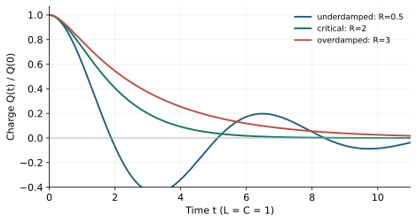

# Chapter 10 — Electromagnetic Oscillations and AC Circuits

A capacitor stores electric-field energy and an inductor stores magnetic-field energy. Connect them together and energy can move back and forth, even without a source. Resistance then introduces damping, while an alternating emf can maintain oscillations. This is the same mathematical structure as a driven, damped spring.

## 10.1 The LC oscillator

Let $Q$ denote charge (coulombs) on one capacitor plate and $I=\dot Q$ the current (amperes) into that plate, using a consistent loop orientation. With no resistance or source, the loop equation is

$$L\ddot Q+\frac QC=0.$$

Here $L$ is inductance in henrys ($\mathrm H$), $C$ is capacitance in farads ($\mathrm F$), and $\omega_0$ is the natural angular frequency in radians per second ($\mathrm{rad/s}$). Thus $\omega_0=1/\sqrt{LC}$ and $Q(t)=Q_0\cos(\omega_0t+\phi)$. The current is $I=\dot Q$, a quarter period out of phase with charge. 

### Magnetic energy stored in an inductor

When the current in an inductor increases, its changing 
magnetic flux produces a self-induced emf,

$$\mathcal E_{\rm self}=-L\frac{dI}{dt}.$$

To overcome this emf, an external source must supply 
a voltage

$$V_L=-\mathcal E_{\rm self}=L\frac{dI}{dt}.$$

For an ideal lossless inductor, the incremental work 
done by the source in moving a charge $dq$ is

$$dW=V_L\,dq.$$

Since $I=dq/dt$, we have $dq=I\,dt$. Therefore,

$$
\begin{aligned}
dW
&=V_L I\,dt\\
&=L\frac{dI}{dt}I\,dt\\
&=LI\,dI.
\end{aligned}
$$

For constant inductance $L$, integrating from zero 
current to the final current $I$ gives

$$
U_L=\int_0^I LI'\,dI'
=\boxed{\frac12LI^2}.
$$

This energy is stored in the magnetic field. When the 
current remains constant, no additional work is required 
to maintain the field in an ideal lossless inductor.

When the current decreases, $dU_L=LI\,dI<0$ 
(for $I>0$ and $dI<0$), and the stored magnetic energy 
is released back into the circuit.

Alternatively, using the flux linkage $\lambda=LI$,

$$dW=V_L I\,dt=I\,d\lambda.$$

Hence,

$$
\boxed{
U_L=\int_0^\lambda I(\lambda')\,d\lambda'
=\frac{\lambda^2}{2L}
=\frac12LI^2
}.
$$

This is analogous to the energy stored in a capacitor,

$$U_C=\int_0^Q V(Q')\,dQ'=\frac{Q^2}{2C}.$$

In both cases, energy is stored by doing work to establish 
an electromagnetic field.

The total ideal energy remains

$$\boxed{U=\frac{Q^2}{2C}+\frac{LI^2}{2}=\mathrm{constant}}.$$

When $Q$ is largest the current is zero and energy is electric; when $Q=0$ the current magnitude is largest and energy is magnetic. This exchange is the physical origin of oscillation.

## 10.2 The same equation as a mechanical oscillator

Adding a resistor of resistance $R$ (ohms, $\mathrm\Omega$) and a source $\mathcal E(t)$ (volts) gives

$$\boxed{L\ddot Q+R\dot Q+\frac QC=\mathcal E(t)}.$$

Compare this with $m\ddot x+b\dot x+kx=F(t)$. The correspondences are $Q\leftrightarrow x$, $I\leftrightarrow\dot x$, $L\leftrightarrow m$, $R\leftrightarrow b$, $1/C\leftrightarrow k$. We can therefore use the same existence, homogeneous-solution and forced-response methods learned for ODEs.

## 10.3 Free damped oscillations

Without a source, try $Q=e^{st}$, where $s$ is a characteristic growth/decay rate ($\mathrm{s^{-1}}$):

$$Ls^2+Rs+\frac1C=0,\qquad s=-\gamma\pm\sqrt{\gamma^2-\omega_0^2},\quad\gamma=\frac R{2L}.$$

If $\gamma<\omega_0$, the roots have an imaginary part and

$$Q(t)=e^{-\gamma t}[A\cos(\omega_dt)+B\sin(\omega_dt)],\quad \omega_d=\sqrt{\omega_0^2-\gamma^2}.$$

If $\gamma=\omega_0$ the response is $(A+Bt)e^{-\gamma t}$ (**critical damping**); if $\gamma>\omega_0$ it is a sum of two decaying real exponentials (**overdamping**). Resistance does not always produce oscillation: it can suppress it altogether.

*Figure 10.1.* Normalised $Q(t)$ with $Q(0)=1$, $\dot Q(0)=0$, $L=C=1$ and three stated resistances; the curves are computed from the actual ODE.

## 10.4 Harmonic driving without repeatedly solving derivatives

For a sinusoidal source of angular frequency $\omega$ ($\mathrm{rad/s}$), $\mathcal E(t)=\operatorname{Re}(\mathcal E_0e^{i\omega t})$, seek the steady current $I(t)=\operatorname{Re}(I_0e^{i\omega t})$. A time derivative then corresponds to multiplication by $i\omega$. The resistor, inductor and capacitor obey the complex voltage–current relations

$$V_R=RI_0,\qquad V_L=i\omega L I_0,\qquad V_C=\frac{I_0}{i\omega C}.$$

The last relation follows from $I=dQ/dt$, hence $Q_0=I_0/(i\omega)$. This is not a new physical law; complex exponentials provide a concise way to handle phase and differentiation, and the real part is the measured signal.

## 10.5 Impedance and phase

Complex impedance $Z$ has units of ohms; it relates voltage and current phasors, not their instantaneous values. For a series RLC circuit, voltages add, so

$$\mathcal E_0=I_0\left[R+i\left(\omega L-\frac1{\omega C}\right)\right]\equiv I_0 Z.$$

Therefore

$$\boxed{Z=R+i\left(\omega L-\frac1{\omega C}\right)},\quad |Z|=\sqrt{R^2+(\omega L-1/\omega C)^2}.$$

The current amplitude is $I_{\max}=|\mathcal E_0|/|Z|$; its phase relative to the source is $-\arg Z$. At low frequency capacitive reactance dominates; at high frequency inductive reactance dominates.

The admittance $Y=1/Z$ is measured in siemens ($\mathrm S=\mathrm{1/\Omega}$). For a parallel network, the same *voltage* appears on each branch and currents add. Thus it is convenient to add admittances $Y=1/Z$: $Y_{\rm eq}=\sum_j1/Z_j$. Do not use the series formula for parallel elements.

## 10.6 Resonance, damping and quality factor

At $\omega=\omega_0=1/\sqrt{LC}$, the reactive terms of the **series** impedance cancel, so $|Z|=R$ and the **current amplitude** is maximal. The dimensionless quality factor $Q_f$ for this circuit is

$$\boxed{Q_f=\frac{\omega_0 L}{R}=\frac1{\omega_0RC}},\quad Q_f\gg1\ \text{means weak damping}.$$

For a series RLC circuit, the half-power bandwidth is $\Delta\omega=R/L$ (using the positive half-power frequencies), so $Q_f=\omega_0/\Delta\omega$. A distinction easily lost in brief accounts: the frequency maximizing **charge amplitude** in a driven RLC system is generally $\sqrt{\omega_0^2-R^2/(2L^2)}$, when this is real—not exactly $\omega_0$. Specify what quantity is resonating.

## 10.7 Power, rms values and power factor

For voltage $v(t)=V_{\max}\cos\omega t$ and current $i(t)=I_{\max}\cos(\omega t-\phi)$, where $\phi$ is their phase difference (radians), multiply and average over one period. The double-frequency term averages to zero:

$$\boxed{\langle P\rangle=\frac12V_{\max}I_{\max}\cos\phi=V_{\rm rms}I_{\rm rms}\cos\phi},$$

where $V_{\rm rms}=V_{\max}/\sqrt2$ and $I_{\rm rms}=I_{\max}/\sqrt2$. The factor $\cos\phi$ is the **power factor**; ideal inductors and capacitors exchange energy with the source over a cycle but dissipate no average power, while the resistor dissipates $I_{\rm rms}^2R$.

## 10.8 Why transformers work

Faraday's law gives an induced voltage proportional to the number of turns $N_1,N_2$ (dimensionless) sharing a changing flux: $|V_1|\simeq N_1|d\Phi/dt|$ and $|V_2|\simeq N_2|d\Phi/dt|$. For an ideal tightly coupled transformer,

$$\boxed{\frac{V_2}{V_1}=\frac{N_2}{N_1}},\qquad\boxed{V_1I_1\simeq V_2I_2}\quad\text{(power magnitudes, ideal case)}.$$

Raising the transmission voltage lowers the current required for the same power and therefore reduces $I^2R$ loss. Real transformers have resistance, imperfect coupling and core losses; they need *time-varying* flux, not a steady dc input.

The lumped-circuit description itself assumes component sizes are small compared with the relevant electromagnetic wavelength, and that radiation and distributed propagation are negligible. Chapter 12 removes that approximation and treats the fields as traveling waves.

---
**Reference.** R. Shankar, *Fundamentals of Physics II: Electromagnetism, Optics, and Quantum Mechanics*, Chapters 12–13;  David Halliday, Robert Resnick and Jearl Walker, *Fundamentals of Physics*, 12th ed., Chapter 31; David J. Griffiths, *Introduction to Electrodynamics*, 5th ed., §§7.2–7.3 (inductance and field context).
