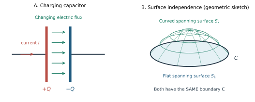

# Chapter 11 — Maxwell's Equations and Conservation Laws

The separate electric and magnetic laws are almost complete, but Ampère's law still assumes steady currents. Maxwell noticed a contradiction when applying it to a capacitor being charged. Resolving that contradiction makes the static laws a single theory of *changing* electromagnetic fields—and predicts energy flow through space.

## 11.1 The missing current between capacitor plates

In magnetostatics, $\oint_C\mathbf B\cdot d\boldsymbol\ell=\mu_0 I_{\rm enc}$, where $I_{\rm enc}$ is current through an oriented surface in amperes, and $\mu_0$ is vacuum permeability ($\mathrm{H/m}$). Choose a loop $C$ around the wire feeding a charging capacitor. One spanning surface intersects the wire and carries current $I$; another spanning surface bulges between the plates and intersects **no conduction current**. The left side is the same loop integral, so Ampère's static equation gives contradictory results for the two surfaces.

*Figure 11.1.* Schematic of a charging capacitor. The dashed curve is one Ampèrian boundary $C$; different spanning surfaces must give the same result. The curved surface is indicated schematically, not as a second conductor.

The clue comes from charge conservation. If $I=dQ/dt$ enters a plate, with plate charge $Q$ in coulombs and time $t$ in seconds, its electric field changes. Between ideal wide plates, $E\simeq Q/(\varepsilon_0A)$, so the electric flux is $\Phi_E\simeq EA=Q/\varepsilon_0$ (generally,$\Phi_E=\int_S\mathbf E\cdot d\mathbf S$). Therefore

$$\varepsilon_0\frac{d\Phi_E}{dt}=\frac{dQ}{dt}=I.$$

Maxwell's correction is the **displacement-current term** $\varepsilon_0\,d\Phi_E/dt$. It is not a stream of charges crossing the vacuum gap; it is the contribution from a changing electric field.

## 11.2 Ampère–Maxwell law

The corrected law uses the same closed boundary but becomes independent of which stationary spanning surface is chosen:

$$\boxed{\oint_C\mathbf B\cdot d\boldsymbol\ell=\mu_0 I_{\rm through\,S}+\mu_0\varepsilon_0\frac d{dt}\int_S\mathbf E\cdot d\mathbf S}.$$

Applying Stokes' theorem to a fixed surface gives the local version:

$$\boxed{\nabla\times\mathbf B=\mu_0\mathbf J+\mu_0\varepsilon_0\frac{\partial\mathbf E}{\partial t}}.$$

There is also a direct consistency check. Take the divergence of both sides: the divergence of a curl vanishes, so

$$0=\mu_0\nabla\cdot\mathbf J+\mu_0\varepsilon_0\partial_t(\nabla\cdot\mathbf E).$$

Using $\nabla\cdot\mathbf E=\rho/\varepsilon_0$ produces $\partial_t\rho+\nabla\cdot\mathbf J=0$—exactly the continuity equation of Chapter 6. Without the added term, the old equation would wrongly demand $\nabla\cdot\mathbf J=0$ even when charge accumulates.

## 11.3 All four equations together

In vacuum (or microscopically, counting **total** charge and current), the complete equations are

$$\boxed{\begin{aligned}
\nabla\cdot\mathbf E&=\rho/\varepsilon_0,\\
\nabla\cdot\mathbf B&=0,\\
\nabla\times\mathbf E&=-\partial_t\mathbf B,\\
\nabla\times\mathbf B&=\mu_0\mathbf J+\mu_0\varepsilon_0\partial_t\mathbf E.
\end{aligned}}$$

Their integral forms apply to fixed surfaces and oriented boundaries:

$$\begin{aligned}
\oint_{\partial V}\mathbf E\cdot d\mathbf S&=Q_{\rm enc}/\varepsilon_0,\\
\oint_{\partial V}\mathbf B\cdot d\mathbf S&=0,\\
\oint_{\partial S}\mathbf E\cdot d\boldsymbol\ell&=-\frac d{dt}\int_S\mathbf B\cdot d\mathbf S,\\
\oint_{\partial S}\mathbf B\cdot d\boldsymbol\ell&=\mu_0 I_{\rm enc}+\mu_0\varepsilon_0\frac d{dt}\int_S\mathbf E\cdot d\mathbf S.
\end{aligned}$$

The first two measure sources through a closed surface; the last two measure circulation around a loop. This distinction explains the appearance of **divergence** versus **curl**. The Lorentz force $\mathbf F=q(\mathbf E+\mathbf v\times\mathbf B)$ then tells matter how to respond to these fields; field equations alone do not specify the particle motion.

## 11.4 Matter: separate bound from free sources

Electric polarisation $\mathbf P$ (units $\mathrm{C/m^2}$) and magnetisation $\mathbf M$ ($\mathrm{A/m}$) were introduced in Chapters 5 and 8. For matter at rest in the chosen frame, a changing polarisation adds a **polarisation current** $\partial_t\mathbf P$ as well as the magnetisation current $\nabla\times\mathbf M$:

$$\rho=\rho_f-\nabla\cdot\mathbf P,\qquad\mathbf J=\mathbf J_f+\partial_t\mathbf P+\nabla\times\mathbf M.$$

Insert these expressions into the microscopic equations and define $\mathbf D=\varepsilon_0\mathbf E+\mathbf P$, $\mathbf H=\mathbf B/\mu_0-\mathbf M$. Rearrangement gives the macroscopic equations

$$\boxed{\begin{aligned}
\nabla\cdot\mathbf D&=\rho_f,\\
\nabla\cdot\mathbf B&=0,\\
\nabla\times\mathbf E&=-\partial_t\mathbf B,\\
\nabla\times\mathbf H&=\mathbf J_f+\partial_t\mathbf D.
\end{aligned}}$$

No approximation such as $\mathbf D=\varepsilon\mathbf E$ was needed to obtain these forms. A **constitutive relation** must still be specified to solve a particular material problem.

## 11.5 Boundary conditions from thin surfaces and loops

Let unit normal $\hat{\mathbf n}$ point from medium 1 to 2. Here $\sigma_f$ is free surface-charge density ($\mathrm{C/m^2}$) and $\mathbf K_f$ is free sheet-current density ($\mathrm{A/m}$). Integrating the macroscopic equations over an infinitesimal pillbox or a tiny loop crossing an interface gives, for finite nonsingular fields and ordinary free surface sources,

$$\boxed{\begin{aligned}
\hat{\mathbf n}\cdot(\mathbf D_2-\mathbf D_1)&=\sigma_f,\\
\hat{\mathbf n}\cdot(\mathbf B_2-\mathbf B_1)&=0,\\
\hat{\mathbf n}\times(\mathbf E_2-\mathbf E_1)&=0,\\
\hat{\mathbf n}\times(\mathbf H_2-\mathbf H_1)&=\mathbf K_f.
\end{aligned}}$$

For the tangential conditions the area of the shrinking loop tends to zero; finite $\partial_t\mathbf B$ and $\partial_t\mathbf D$ then give no finite flux contribution. These relations connect the solutions on two sides of a boundary without saying they have the same permittivity or permeability.

## 11.6 Scalar and vector potentials

Because $\nabla\cdot\mathbf B=0$, write $\mathbf B=\nabla\times\mathbf A$. Substituting into Faraday's law gives $\nabla\times(\mathbf E+\partial_t\mathbf A)=0$. Locally the quantity in parentheses is a gradient, so

$$\boxed{\mathbf E=-\nabla\phi-\partial_t\mathbf A},\qquad\boxed{\mathbf B=\nabla\times\mathbf A}.$$

The magnetic vector potential $\mathbf A$ has units $\mathrm{Wb/m}$; the scalar potential $\phi$ has units of volts. For any smooth gauge function $\chi(\mathbf r,t)$ (webers), the change $\mathbf A\mapsto\mathbf A+\nabla\chi$ and $\phi\mapsto\phi-\partial_t\chi$ leaves both fields unchanged. This is **gauge freedom**. It is an equivalence of descriptions, not a new physical force; choosing a particular gauge is deferred.

## 11.7 Where electromagnetic energy goes

Energy was already stored in electric and magnetic fields. Now it can also flow. Dot the Ampère–Maxwell law with $\mathbf E$, and Faraday's law with $\mathbf B$. Subtract using the vector identity

$$\nabla\cdot(\mathbf E\times\mathbf B)=\mathbf B\cdot(\nabla\times\mathbf E)-\mathbf E\cdot(\nabla\times\mathbf B).$$

Inserting the two curl equations produces

$$\frac{\partial}{\partial t}\left(\frac{\varepsilon_0 E^2}{2}+\frac{B^2}{2\mu_0}\right)+\nabla\cdot\left(\frac{\mathbf E\times\mathbf B}{\mu_0}\right)=-\mathbf J\cdot\mathbf E.$$

Call the expression in parentheses $u$ (field energy per volume, $\mathrm{J/m^3}$) and the vector $\mathbf S$ (Poynting vector, energy flux per area per time, $\mathrm{W/m^2}$):

$$\boxed{u=\frac12\varepsilon_0E^2+\frac{B^2}{2\mu_0}},\quad\boxed{\mathbf S=\frac1{\mu_0}\mathbf E\times\mathbf B}.$$

Thus **Poynting's theorem** reads

$$\boxed{\partial_tu+\nabla\cdot\mathbf S=-\mathbf J\cdot\mathbf E}.$$

The three terms mean, respectively, change in field energy, net energy carried out of a volume, and power transferred from field to charges. The source can be inside a resistor, but the energy flow is described by the *fields around it*. This derivation is for microscopic vacuum-form fields; macroscopic energy accounting in dispersive matter requires care.

## 11.8 Momentum is also carried by fields

In vacuum the electromagnetic momentum density is $\mathbf g=\mathbf S/c^2$, in $\mathrm{kg/(m^2\,s)}$, where $c$ is the speed of light in vacuum ($\mathrm{m/s}$). A field can therefore exert pressure or transfer impulse to matter. The full local momentum balance uses the Maxwell stress tensor; for a foundation-level guide, recognising field momentum and its conservation is enough. Chapter 12 makes this concrete for plane waves.

---
**Reference.** R. Shankar, *Fundamentals of Physics II: Electromagnetism, Optics, and Quantum Mechanics*, §13.3, Chapter 14 and §§15.7–15.9;  David Halliday, Robert Resnick and Jearl Walker, *Fundamentals of Physics*, 12th ed., Chapters 32–33; David J. Griffiths, *Introduction to Electrodynamics*, 5th ed., Chapters 7–8 and §10.1.
