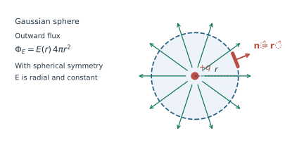

# Chapter 2 — Gauss's Law

Coulomb's law tells us how to add the field produced by each charge, but direct integration is often unnecessarily difficult. Gauss's law asks a different question: what is the *total electric field crossing a closed surface*? The answer depends only on the charge inside, even if the field on the surface is complicated.

## 2.1 Flux and oriented area

A surface element $dS$ (square metres, $\mathrm{m^2}$) has an oriented area vector $d\mathbf S=\hat{\mathbf n}\,dS$, where $\hat{\mathbf n}$ is its unit normal and $\theta$ is the angle between $\mathbf E$ and the normal. Only the component of $\mathbf E$ normal to it crosses the surface:

$$
d\Phi_E=\mathbf E\cdot d\mathbf S=E\cos\theta\,dS,\qquad \Phi_E=\int_S\mathbf E\cdot d\mathbf S.
$$

Electric flux $\Phi_E$ has units $\mathrm{N\,m^2/C}$. For a closed surface the normal is defined outward, so outward flux is positive and inward flux negative. Electric flux is a mathematical surface integral; picturing field lines passing through a surface is useful, but the number of lines drawn is arbitrary.

## 2.2 Why solid angle appears

A small area $dS$ at distance $r$ from a point subtends the *signed solid angle*

$$
d\Omega=\frac{\hat{\mathbf r}\cdot d\mathbf S}{r^2}.
$$

Here $\hat{\mathbf r}$ points from the source to the area patch and $r$ is that distance. It is projected area divided by distance squared. A sphere viewed from its centre covers $4\pi$ steradians ($\mathrm{sr}$; dimensionless in SI). Remarkably, any closed surface enclosing the point subtends the same total signed solid angle $4\pi$: deforming the surface changes projected area and distance in compensating ways. If the point lies outside, positive and negative contributions cancel, giving zero.

## 2.3 Coulomb's law gives Gauss's law

For one charge $q$, Coulomb's field is radial. Its flux through any small surface patch is therefore

$$
d\Phi_E=\frac{q}{4\pi\varepsilon_0r^2}\hat{\mathbf r}\cdot d\mathbf S=\frac{q}{4\pi\varepsilon_0}\,d\Omega.
$$

Integrating over a closed surface gives $q/\varepsilon_0$ if the point charge lies inside and zero if it lies outside. Because flux is linear in the field, superposition extends this result to any charge distribution:

$$
\boxed{\oint_{\partial V}\mathbf E\cdot d\mathbf S=\frac{Q_{\rm enc}}{\varepsilon_0}}.
$$

The surface need not be spherical. Notice also that $Q_{\rm enc}=0$ means *zero net flux*, not necessarily $\mathbf E=0$ at points on that surface.

## 2.4 When Gauss's law calculates the field

Gauss's law always constrains flux, but it gives the field immediately only when symmetry tells us the field's direction and magnitude over a suitable *imaginary Gaussian surface*.

A spherically symmetric source has radial field $E(r)$. On a sphere of radius $r$ it is constant, so

$$
E(r)(4\pi r^2)=\frac{Q_{\rm enc}(r)}{\varepsilon_0}\quad\Rightarrow\quad\boxed{\mathbf E(r)=\frac{Q_{\rm enc}(r)}{4\pi\varepsilon_0r^2}\hat{\mathbf r}}.
$$

*Figure 2.1.* The shaded sphere is an **imaginary** Gaussian surface, not a material shell. This simplification requires a spherically symmetric source.

*Figure 2.1.* The shaded sphere is an **imaginary** Gaussian surface, not a material shell. This simplification requires a spherically symmetric source.

For a uniformly charged solid sphere with total charge $Q$ (coulombs) and radius $R$ (metres), $Q_{\rm enc}(r)=Q(r/R)^3$ for $r<R$:

$$
\mathbf E(r)=\begin{cases}\dfrac{Qr}{4\pi\varepsilon_0R^3}\hat{\mathbf r},&r<R,\\[4pt]\dfrac{Q}{4\pi\varepsilon_0r^2}\hat{\mathbf r},&r\ge R.\end{cases}
$$

An infinite line with linear charge density $\lambda$ ($\mathrm{C/m}$) has cylindrical symmetry. A coaxial cylinder of radius $r$ and length $L$ has no flux through its ends, hence

$$
E(2\pi rL)=\frac{\lambda L}{\varepsilon_0}\quad\Rightarrow\quad\boxed{E=\frac{\lambda}{2\pi\varepsilon_0r}}.
$$

An infinite plane with surface charge density $\sigma$ ($\mathrm{C/m^2}$) has equal-magnitude fields on its two sides. A pillbox of area $A$ encloses $\sigma A$, hence $2EA=\sigma A/\varepsilon_0$ and $|E|=|\sigma|/(2\varepsilon_0)$. These results agree with the direct integrations in Chapter 1 but require less calculation.

## 2.5 Divergence is local flux

Gauss's law is a statement about a whole surface. To convert it into a local law, imagine a small rectangular box. For its two $x$-faces, the net flux is

$$
[E_x(x+\Delta x)-E_x(x)]\Delta y\Delta z\simeq\frac{\partial E_x}{\partial x}\Delta V.
$$

Adding the $y$- and $z$-face pairs gives

$$
\Delta\Phi_E\simeq\left(\frac{\partial E_x}{\partial x}+\frac{\partial E_y}{\partial y}+\frac{\partial E_z}{\partial z}\right)\Delta V.
$$

The expression in parentheses is the **divergence** $\nabla\cdot\mathbf E$: net outward flux per unit volume in the shrinking-box limit. A positive divergence indicates a local field source; a negative divergence indicates net inward flow.

## 2.6 Integral and Differential Forms

By the divergence theorem, $\oint_{\partial V}\mathbf E\cdot d\mathbf S=\int_V\nabla\cdot\mathbf E\,dV$. Since $Q_{\mathrm{enc}}=\int_V\rho\,dV$,

$$
\int_V\left(\nabla\cdot\mathbf E-\frac{\rho}{\varepsilon_0}\right)dV=0.
$$

Here $\rho$ is charge per unit volume ($\mathrm{C/m^3}$). Since the region $V$ is arbitrary, for a sufficiently regular charge density the integrands must agree locally:

$$
\boxed{\nabla\cdot\mathbf E=\frac{\rho}{\varepsilon_0}}.
$$

**What happens at a point charge?** For a point charge $q$ at the origin, Coulomb's law gives

$$
\mathbf E=\frac{q}{4\pi\varepsilon_0}\frac{\mathbf r}{r^3}.
$$

Direct differentiation gives $\nabla\cdot(\mathbf r/r^3)=0$ for $r\neq0$. However, the flux through any sphere centred at the origin is

$$
\oint_S\frac{\mathbf r}{r^3}\cdot d\mathbf S
=\frac{1}{r^2}(4\pi r^2)=4\pi.
$$

Thus, the divergence is zero everywhere except at the origin, yet its integral over any volume enclosing the origin must equal $4\pi$. This is precisely the property of the three-dimensional Dirac delta, whose integral is $1$ if the origin is enclosed and $0$ otherwise. Hence, in the distributional sense,

$$
\boxed{\nabla\cdot\left(\frac{\mathbf r}{r^3}\right)=4\pi\delta^{(3)}(\mathbf r)}.
$$

The point charge is therefore represented by $\rho=q\delta^{(3)}(\mathbf r)$, keeping the differential form of Gauss's law consistent with its integral form.

## 2.7 The Normal Field at a Charged Interface

Consider a surface carrying charge density $\sigma_s$ ($\mathrm{C/m^2}$), separating regions 1 and 2. To determine how the electric field changes across it, choose a very thin Gaussian pillbox of face area $A$ straddling the interface, with unit normal $\hat{\mathbf n}$ pointing from side 1 to side 2.

As the pillbox height approaches zero, its side-wall area and hence its flux vanish, leaving only the two faces. Their outward normals point in opposite directions, so Gauss's law gives

$$
\oint_S\mathbf E\cdot d\mathbf S
=(\mathbf E_2\cdot\hat{\mathbf n})A
-(\mathbf E_1\cdot\hat{\mathbf n})A
=\frac{\sigma_s A}{\varepsilon_0}.
$$

Cancelling $A$,

$$
\boxed{(\mathbf E_2-\mathbf E_1)\cdot\hat{\mathbf n}
=\frac{\sigma_s}{\varepsilon_0}}.
$$

Thus, **surface charge produces a discontinuity in the normal component of the electric field**. If $\sigma_s=0$, this component is continuous.

Gauss's law determines only the **normal** component because electric flux measures the field perpendicular to a surface. The tangential condition follows from $\oint\mathbf E\cdot d\boldsymbol\ell=0$ in electrostatics, using a shrinking rectangular loop across the interface. This becomes especially useful for conductors in Chapter 4.

---
**Reference.** R. Shankar, *Fundamentals of Physics II: Electromagnetism, Optics, and Quantum Mechanics*, Chapters 3–4 and §14.7;  David Halliday, Robert Resnick and Jearl Walker, *Fundamentals of Physics*, 12th ed., Chapter 23; David J. Griffiths, *Introduction to Electrodynamics*, 5th ed., Chapters 1–2 (divergence and boundary conditions).
