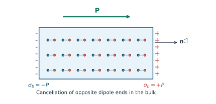

# Chapter 5 — Dielectrics and Polarisation

Until now, charge distributions were specified directly. Inside an insulator, however, an applied field can slightly separate positive and negative charges without allowing them to flow through the material. We need a way to describe these many microscopic displacements by a macroscopic field.

## 5.1 Which charges appear in Gauss's law?

Gauss's law counts **all** electric charge. In matter we distinguish charge supplied or transported macroscopically (**free**) from charge created by displacement or orientation within the material (**bound**):

```math
\rho=\rho_f+\rho_b,\qquad \nabla\cdot\mathbf E=\frac{\rho_f+\rho_b}{\varepsilon_0}.
```

The densities $\rho_f$ and $\rho_b$ have units $\mathrm{C/m^3}$; the field $\mathbf E$ has units $\mathrm{V/m}$. Both contribute to the *same* electric field. This division is a bookkeeping choice for material response, not a new kind of force. The next task is to express $\rho_b$ in terms of the microscopic displacements.

## 5.2 From one atom to an electric dipole

An electric field shifts an electron cloud slightly relative to its positive nucleus; in a polar molecule it can also turn an existing dipole. A neutral object may therefore have a nonzero dipole moment. For charges $-q$ and $+q$ at $\mathbf r_-$ and $\mathbf r_+$,

```math
\boxed{\mathbf p=q(\mathbf r_+-\mathbf r_-)}.
```

The displacement $\mathbf r_+-\mathbf r_-$ is in metres, so the dipole moment $\mathbf p$ is measured in $\mathrm{C\,m}$. The vector points from negative to positive charge, even when the *electron* moves in the opposite direction. In a small volume $\Delta V$ containing many atoms or molecules, add their moments:

```math
\boxed{\mathbf P(\mathbf r)\simeq\frac{1}{\Delta V}\sum_{i\in\Delta V}\mathbf p_i},\qquad [\mathbf P]=\mathrm{C\,m^{-2}}.
```

$\Delta V$ must contain many particles but be small compared with variations in the macroscopic material. Thus $\mathbf P$ is **electric dipole moment per unit volume** (usually we call it **Polarization density**); for $n$ equally oriented identical dipoles in unit volume, $\mathbf P=n\mathbf p$. This averaging is why an atomic picture becomes a smooth field.

## 5.3 Why a polarised surface carries charge

Imagine aligned dipoles of length $d$ normal to a flat boundary, with number density $n$. Adjacent positive and negative ends cancel in the interior. Only an outermost layer of thickness $d$ remains uncompensated. For its area $A$,

```math
N=nAd,\qquad Q_{b,\rm surface}=Nq=nAdq.
```

Here $n$ is the number of dipoles per volume ($\mathrm{m^{-3}}$), $A$ is area ($\mathrm{m^2}$), and $d$ is the normal separation ($\mathrm m$). Divide by area and recall $p=qd$:

```math
\sigma_b=\frac{Q_{b,\rm surface}}A=nqd=np=P.
```

Only the component along the **outward normal** contributes at an arbitrarily oriented boundary, so

```math
\boxed{\sigma_b=\mathbf P\cdot\hat{\mathbf n}}.
```

The picture explains the sign: $\mathbf P$ pointing *out* leaves positive bound charge; pointing *in* leaves negative bound charge. This holds for a surface separating the polarised material from vacuum; at an interface between two polarised media the relevant normal jump is $\sigma_{b,\rm interface}=(\mathbf P_1-\mathbf P_2)\cdot\hat{\mathbf n}_{1\to2}$.



*Figure 5.1.* Uniform $\mathbf P$ leaves bound surface sheets; neighbouring interior charges cancel. The drawing represents the effective charge layers, not individual electrons to scale.

## 5.4 Why nonuniform polarisation creates volume charge

Uniform $\mathbf P$ cancels internally, but when the dipole density or orientation changes with position the cancellation is incomplete. Take any small macroscopic region $V$ *inside* the dielectric. The effective charge exposed on its imaginary cut is $\oint_{\partial V}\sigma_b  dS=\oint_{\partial V}\mathbf P\cdot d\mathbf S$. Since the microscopic dipoles crossing that cut are neutral as complete objects, the residual bound charge within the region has the opposite sign:

```math
Q_{b,\rm bulk}=-\oint_{\partial V}\mathbf P\cdot d\mathbf S.
```

Use the divergence theorem and $Q_{b,\rm bulk}=\int_V\rho_b\,dV$:

```math
\int_V\rho_b\,dV=-\int_V\nabla\cdot\mathbf P\,dV.
```

As $V$ can be chosen arbitrarily,

```math
\boxed{\rho_b=-\nabla\cdot\mathbf P}.
```

The first formula describes charge on a *physical boundary*, the second charge left in the *bulk*. They are not two names for the same location. Across a material boundary, a discontinuity in $\mathbf P$ appears as a bound surface sheet, consistent with the same divergence law in distribution form.

## 5.5 Return to Gauss's law: the displacement field

Substitute the bound volume charge into the original Maxwell equation:

```math
\nabla\cdot\mathbf E=\frac{\rho_f-\nabla\cdot\mathbf P}{\varepsilon_0}
```

```math
\nabla\cdot(\varepsilon_0\mathbf E+\mathbf P)=\rho_f.
```

The combination appears naturally, so call it the **electric displacement field**:

```math
\boxed{\mathbf D\equiv\varepsilon_0\mathbf E+\mathbf P},\qquad\boxed{\nabla\cdot\mathbf D=\rho_f}.
```

The field $\mathbf D$ has units $\mathrm{C/m^2}$, as does $\varepsilon_0\mathbf E$. This is a convenient form of Gauss's law that counts only *free* charge on the right. It does **not** say that bound charge no longer produces an electric field. Nor does it tell us the relation between $\mathbf P$ and $\mathbf E$; for that, we need a model of the material.

## 5.6 Why a weak field gives a linear response

For a simple nonpolar atom, the electron cloud is most stable near equilibrium. A small displacement $\mathbf x$ (metres) makes its potential energy approximately quadratic, $U(x)\simeq U(0)+kx^2/2$, producing the restoring force $\mathbf F_r=-k\mathbf x$, with effective stiffness $k$ ($\mathrm{N/m}$). The Lorentz **oscillator model** uses $\mathbf F_e=-e\mathbf E_{\rm loc}$ for an electron in the local field. Static equilibrium gives

```math
-k\mathbf x-e\mathbf E_{\rm loc}=0\quad\Longrightarrow\quad\mathbf x=-\frac e k\mathbf E_{\rm loc}.
```

The nucleus is positive, so the induced atomic dipole is $\mathbf p=-e\mathbf x$. The coefficient $\alpha$ is the atomic polarisability, with units $\mathrm{C\,m^2/V}$:

```math
\boxed{\mathbf p=\frac{e^2}{k}\mathbf E_{\rm loc}\equiv\alpha\mathbf E_{\rm loc}}.
```

With $n$ such atoms per unit volume, $\mathbf P=n\alpha\mathbf E_{\rm loc}$. In a sufficiently dilute medium, approximate the local field by the averaged field, $\mathbf E_{\rm loc}\simeq\mathbf E$ (the reason why it differs from the macroscopic electric field is that the local electric field is influenced by the electric field produced by neighbouring atoms). Define the electric susceptibility $\chi_e$ by writing this response as

```math
\boxed{\mathbf P=\varepsilon_0\chi_e\mathbf E},\qquad \chi_e\simeq\frac{n\alpha}{\varepsilon_0}=\frac{ne^2}{\varepsilon_0k}.
```

The susceptibility $\chi_e$ and relative permittivity $\varepsilon_r$ are dimensionless; $\varepsilon$ has units $\mathrm{F/m}$. The spring law was an *approximation*, not a Maxwell equation. Dense media have local-field corrections; permanent dipoles can reorient, while strong fields, crystals and changing frequencies can invalidate the simple scalar $\chi_e$.

## 5.7 The constitutive relation

Now return to the definition of $\mathbf D$ and insert the **linear, isotropic** response:

```math
\mathbf D=\varepsilon_0\mathbf E+\varepsilon_0\chi_e\mathbf E=\varepsilon_0(1+\chi_e)\mathbf E.
```

With $\varepsilon_r=1+\chi_e$ and $\varepsilon=\varepsilon_0\varepsilon_r$,

```math
\boxed{\mathbf D=\varepsilon\mathbf E}.
```

Keep the logical distinction: $\mathbf D=\varepsilon_0\mathbf E+\mathbf P$ is a **definition**; $\nabla\cdot\mathbf D=\rho_f$ is a **field equation**; $\mathbf P=\varepsilon_0\chi_e\mathbf E$ is a **material approximation**. In anisotropic matter $\varepsilon$ is generally a tensor rather than a single number.


## 5.8 Interfaces, Dielectric Capacitors and Energy

### 5.8.1 Boundary Conditions at Dielectric Interfaces

Consider an interface between two dielectrics, with the unit normal $\hat{\mathbf n}$ pointing from medium 1 to medium 2.

First, take a very thin Gaussian pillbox crossing the interface. As its height approaches zero, the flux through its side surface vanishes, leaving only the two faces.

From Gauss's law for the electric displacement field,

```math
\oint_S \mathbf D\cdot d\mathbf S=Q_f,
```

where $Q_f$ is the enclosed free charge. For a pillbox of face area $A$, the enclosed charge is $Q_f=\sigma_f A$, where $\sigma_f$ is the free surface charge density. Hence,

```math
(\mathbf D_2\cdot\hat{\mathbf n})A
+[\mathbf D_1\cdot(-\hat{\mathbf n})]A=
(\mathbf D_2\cdot\hat{\mathbf n})A
-(\mathbf D_1\cdot\hat{\mathbf n})A
=\sigma_f A.
```

Therefore,

```math
\boxed{\hat{\mathbf n}\cdot(\mathbf D_2-\mathbf D_1)=\sigma_f}.
```

**The normal component of $\mathbf D$ is continuous unless free surface charge is present.**

Next, consider a very thin rectangular loop crossing the interface, with its long sides parallel to the surface. In electrostatics,

```math
\oint_C\mathbf E\cdot d\mathbf l=0.
```

As the loop height approaches zero, contributions from the two short sides vanish. The remaining contributions have opposite orientations:

```math
E_{2,\parallel}l-E_{1,\parallel}l=0.
```

Thus,

```math
\boxed{\hat{\mathbf n}\times(\mathbf E_2-\mathbf E_1)=0}.
```

**The tangential component of $\mathbf E$ is continuous across the interface.**

### 5.8.2 Dielectric Capacitors

Consider a wide parallel-plate capacitor of plate area $A$ and separation $d$, completely filled with a homogeneous, linear and isotropic dielectric. We neglect edge effects so that the electric field is uniform.

The free charge $Q$ on either plate produces an electric displacement field. Using Gauss's law,

```math
\oint_S\mathbf D\cdot d\mathbf S=Q_f
\quad\Rightarrow\quad
DA=Q.
```

For a linear dielectric,

```math
\mathbf D=\varepsilon\mathbf E,
\qquad
\varepsilon=\varepsilon_0\varepsilon_r,
```

where $\varepsilon$ is the material permittivity ($\mathrm{F/m}$), $\varepsilon_0$ is the vacuum permittivity, and $\varepsilon_r$ is the dimensionless relative permittivity.

Therefore,

```math
D=\frac QA
\quad\Rightarrow\quad
E=\frac{Q}{\varepsilon A}.
```

The potential difference is determined by the **actual electric field**:

```math
V=-\int\mathbf E\cdot d\mathbf l.
```

Since the field is uniform, the magnitude of the potential difference between the plates is $V=Ed$. Hence,

```math
V=\frac{Qd}{\varepsilon A}.
```

Using the definition of capacitance,

```math
C=\frac QV
=\frac{\varepsilon A}{d}.
```

Without the dielectric, $C_0=\varepsilon_0 A/d$, so

```math
\boxed{C=\varepsilon_r C_0}.
```

**Why does capacitance increase?**

The applied field polarises the dielectric, producing bound surface charges whose field opposes the field of the free charges.

For the same free plate charge $Q$, the field without the dielectric would be

```math
E_{\mathrm{free}}=\frac{Q}{\varepsilon_0 A}.
```

The actual field inside the dielectric is the superposition of the fields produced by free and bound charges:

```math
\mathbf E=\mathbf E_{\mathrm{free}}+\mathbf E_{\mathrm{bound}}.
```

In this geometry,

```math
E=\frac{E_{\mathrm{free}}}{\varepsilon_r}
\quad\Rightarrow\quad
\boxed{E_{\mathrm{free}}=\varepsilon_r E}.
```

Thus, $\varepsilon_r E$ represents the equivalent field of the same free charges without the dielectric, while $E$ is the actual field determining the physical potential difference.

With fixed $Q$, polarisation reduces $E$ and hence $V$. Since $C=Q/V$, capacitance increases.

If the capacitor remains connected to an ideal battery, however, $V$ is fixed. The battery supplies additional free charge to maintain the field $E=V/d$ as the dielectric is inserted. Consequently, $Q=CV$ increases instead.

### 5.8.3 Energy Stored in a Dielectric

The energy density of a linear, nondispersive dielectric can be obtained from the reversible work required to establish the electric field:

```math
du=\mathbf E\cdot d\mathbf D.
```

Since $\mathbf D=\varepsilon\mathbf E$, the fields are proportional. Integrating from zero field to the final field gives

```math
u=\int_0^{D}E(D')\,dD'
=\frac12 ED.
```

Therefore,

```math
\boxed{
u=\frac12\mathbf E\cdot\mathbf D
=\frac12\varepsilon E^2
},
```

where $u$ is the electrostatic energy density ($\mathrm{J/m^3}$).

For a linear capacitor,

```math
U=\frac12 QV
=\frac{Q^2}{2C}
=\frac12 CV^2.
```

The effect of inserting a dielectric depends on what remains constant.

**Isolated capacitor:** $Q$ is fixed, so increasing $C$ decreases the stored energy:

```math
U=\frac{Q^2}{2C}\downarrow.
```

**Battery-connected capacitor:** $V$ is fixed, so increasing $C$ increases the stored energy:

```math
U=\frac12 CV^2\uparrow.
```

In the second case, the extra energy comes from the battery. The capacitor is not an isolated system, so its energy change alone does not determine the mechanical work done during dielectric insertion.


## 5.9 What the simple model leaves out

Restoring force, inertia and damping together give $m\ddot x+m\gamma\dot x+kx=-eE(t)$. Here $m$ is the effective electron mass (kilograms), $\gamma$ the damping rate ($\mathrm{s^{-1}}$), and $\omega$ the angular frequency ($\mathrm{rad/s}$). For harmonic driving with the convention $E(t)=\mathrm{Re}(E_0e^{-i\omega t})$,

```math
\alpha(\omega)=\frac{e^2}{k-m\omega^2-im\gamma\omega}.
```

This explains *why* real permittivity can depend on frequency and have an absorptive imaginary part. Detailed dispersion, local-field theory and nonlinear response belong to electrodynamics; the static constitutive law above is sufficient for the present chapter.

---
**Reference.** R. Shankar, *Fundamentals of Physics II: Electromagnetism, Optics, and Quantum Mechanics*, §§2.5–2.6 and 6.5 (dipole/capacitor foundations); David Halliday, Robert Resnick and Jearl Walker, *Fundamentals of Physics*, 12th ed., Chapter 25; David J. Griffiths, *Introduction to Electrodynamics*, 5th ed., Chapter 4 (bound charge, displacement field and constitutive relations).
