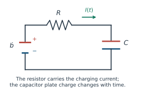

# Chapter 6 — Electric Currents and DC Circuits

In electrostatics charges have finished rearranging. A circuit keeps them moving, so we must describe how much charge crosses a surface each second, what sustains the motion, and how energy is transferred. The circuit formulas will follow from charge conservation and a material law.

## 6.1 From moving charges to current density

A charge $dQ$ (coulombs) crossing a surface in time $dt$ (seconds) defines current $I=dQ/dt$, measured in amperes ($1\,\mathrm A=1\,\mathrm{C/s}$). Its positive direction is that of positive-charge motion; electrons usually drift oppositely. If mobile carriers have number density $n$ ($\mathrm{m^{-3}}$), charge $q$ (coulombs), drift velocity $\mathbf v_d$ ($\mathrm{m/s}$) and cross-sectional area $A$ ($\mathrm{m^2}$) perpendicular to the flow, a length $v_d\,dt$ crosses it in time $dt$:

```math
dQ=nq(Av_d\,dt)\quad\Longrightarrow\quad I=nqAv_d.
```

The general form uses **current density** $\mathbf J=nq\mathbf v_d$ (sum over carrier species if needed):

```math
\boxed{I=\int_S\mathbf J\cdot d\mathbf S},\qquad [\mathbf J]=\mathrm{A\,m^{-2}}.
```

Current is a *flux of charge*, not the speed of individual electrons. Carriers can have a small average drift speed while an electric signal propagates much faster through a circuit.

## 6.2 Local conservation of charge

Take a fixed volume $V$. Any net outward current must reduce the charge inside it:

```math
\frac{d}{dt}\int_V\rho\,dV=-\oint_{\partial V}\mathbf J\cdot d\mathbf S.
```

For a fixed region, move the time derivative inside and use the divergence theorem. Since $V$ can be arbitrary,

```math
\boxed{\frac{\partial\rho}{\partial t}+\nabla\cdot\mathbf J=0}.
```

This is the **continuity equation**, the local form of charge conservation promised in Chapter 1. Under steady conditions $\partial_t\rho=0$, so $\nabla\cdot\mathbf J=0$: a current cannot simply end inside the material.

## 6.3 Why conductors obey Ohm's law

Experimentally, many conductors at fixed temperature respond approximately linearly to moderate electric fields. Locally this is

```math
\boxed{\mathbf J=\sigma\mathbf E},\qquad \rho_{\mathrm{res}}=\sigma^{-1}.
```

Here $\sigma$ is conductivity ($\mathrm{S/m}$, siemens per metre), not surface charge density; $\rho_{\mathrm{res}}$ is *resistivity* ($\mathrm{\Omega\,m}$), not charge density $\rho$. For a uniform wire of length $L$ (metres) and cross-section $A$, $J=I/A$ and $E\simeq V/L$, giving

```math
\frac IA=\sigma\frac VL\quad\Longrightarrow\quad\boxed{V=IR},\qquad\boxed{R=\rho_{\mathrm{res}}\frac LA}.
```

Resistance $R$ is measured in ohms ($\mathrm\Omega=\mathrm{V/A}$). Ohm's law is therefore a **material relation**, not a universal consequence of Maxwell's equations. Non-ohmic components and temperature-dependent resistance need different models.

## 6.4 Drude's explanation of conductivity

Why should drift be proportional to the field? In the classical Drude model a charge carrier of mass $m$ (kilograms) accelerates under $q\mathbf E$, but collisions relax its mean momentum on a timescale $\tau$ (seconds). The mean steady-state equation is

```math
m\frac{d\mathbf v_d}{dt}=q\mathbf E-\frac{m\mathbf v_d}{\tau},\qquad \frac{d\mathbf v_d}{dt}=0.
```

In Drude model, each scattering event is assumed to randomise the carrier's motion, reducing its average drift momentum from ${m\mathbf v_d}$ to zero, with an average time $\tau$ between scattering events, this gives an effective opposing force of $-\frac{m\mathbf v_d}{\tau}$, which balances the electric force at steady state, resulting in zero average acceleration.

Thus $\mathbf v_d=q\tau\mathbf E/m$. For electron charge $q=-e$ the velocity opposes $\mathbf E$, yet $\mathbf J=nq\mathbf v_d$ points *along* $\mathbf E$:

```math
\mathbf J=\frac{nq^2\tau}{m}\mathbf E,\qquad\boxed{\sigma=\frac{ne^2\tau}{m_e}}.
```

This accounts for a simple linear law and Joule heating. It is not a microscopic quantum theory of metals; the relaxation time is a phenomenological description of scattering.

## 6.5 Power and electromotive force

Moving charge $dq$ through a potential drop $V$ (volts) releases electric energy $V\,dq$. Per unit time, the power supplied to a resistor is

```math
\boxed{P=IV=I^2R=\frac{V^2}{R}},\qquad p_{\rm volume}=\mathbf J\cdot\mathbf E.
```

Here $P$ is power in watts ($\mathrm W=\mathrm{J/s}$) and $p_{\rm volume}$ is power dissipated per volume ($\mathrm{W/m^3}$).

A *static* electrostatic field cannot supply net work around a closed loop, because its line integral vanishes. A battery therefore needs **non-electrostatic forces** (chemical forces, for example) to carry charge from lower to higher electric potential internally. Their work per unit charge defines the electromotive force:

```math
\boxed{\mathcal E=\oint\frac{\mathbf f_{\rm non\text{-}electrostatic}}q\cdot d\mathbf l}.
```

The symbol $\mathbf f_{\rm non\text{-}electrostatic}$ denotes a non-electric force on one charge (newtons). Despite its name, emf $\mathcal E$ has units of volts, not newtons. For a real battery with internal resistance $r$ (ohms), the terminal voltage during discharge is $V=\mathcal E-Ir$.

## 6.6 Kirchhoff's laws from field principles

At any ideal circuit node, no charge accumulates, so the currents entering equal those leaving:

```math
\boxed{\sum_{\rm node}I_k=0}.
```

In the **quasistatic circuit approximation**, the changing magnetic flux linked by a loop is negligible, so the electrostatic potential changes around the loop sum to zero:

```math
\boxed{\sum_{\rm loop}\Delta V_k=0}.
```

When substantial magnetic flux changes through the loop, Faraday's law replaces this second rule by $\oint\mathbf E\cdot d\mathbf l=-d\Phi_B/dt$. Voltage-loop rules are not universally exact under arbitrary time-dependent fields.

## 6.7 Networks and measuring instruments

Two resistors in series carry the same current, and their voltage drops add: $R_{\rm eq}=\sum R_i$. Two resistors in parallel share the same voltage, and their currents add: $R_{\rm eq}^{-1}=\sum_iR_i^{-1}$. This follows directly from $V=IR$ plus the node/loop rules.

An ammeter is connected **in series** and should have very low internal resistance; a voltmeter is connected **in parallel** and should have very high resistance. Otherwise the instrument changes the circuit it is measuring.

## 6.8 RC charging and discharging

A capacitor stores charge $Q=CV$ (Chapter 4). Connect an uncharged capacitor through resistance $R$ to constant emf $\mathcal E$. The loop equation is $\mathcal E=IR+Q/C$, and $I=dQ/dt$:



*Figure 6.1.* The labelled current direction follows conventional positive-charge motion. Capacitor charge $Q(t)$ builds up while the current falls.


*Figure 6.1.* The labelled current direction follows conventional positive-charge motion. Capacitor charge $Q(t)$ builds up while the current falls.


```math
R\frac{dQ}{dt}+\frac QC=\mathcal E.
```

Separate variables, with $Q(0)=0$:

```math
\frac{dQ}{C\mathcal E-Q}=\frac{dt}{RC}\quad\Longrightarrow\quad\boxed{Q(t)=C\mathcal E(1-e^{-t/RC})},
```

```math
\boxed{I(t)=\frac{\mathcal E}{R}e^{-t/RC}},\qquad \tau_{RC}=RC.
```

The time constant $\tau_{RC}$ is measured in seconds; after one such interval the initial charging current has fallen to $1/e$ of its value.

The current is largest initially when the capacitor is empty, then dies away as $V_C$ approaches $\mathcal E$. During discharge with no battery, $Q(t)=Q_0e^{-t/RC}$. This is the first example of a circuit behaving as a dynamical system rather than a static network.

---
**Reference.** R. Shankar, *Fundamentals of Physics II: Electromagnetism, Optics, and Quantum Mechanics*, Chapter 7 and §15.7.1;  David Halliday, Robert Resnick and Jearl Walker, *Fundamentals of Physics*, 12th ed., Chapters 26–27; David J. Griffiths, *Introduction to Electrodynamics*, 5th ed., current-density, induction and conservation sections.
