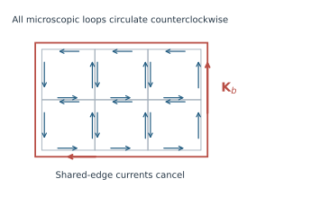

# Chapter 8 — Magnetisation and Magnetic Materials

A permanent magnet produces a field even though no wire is carrying an imposed current. The explanation comes from microscopic magnetic moments. Just as electric polarisation represented many displaced charges by $\mathbf P$, **magnetisation** represents many microscopic magnetic moments by a field $\mathbf M$.

## 8.1 Microscopic moments

### From orbital motion to intrinsic spin

Consider a particle of mass $m_e$ and charge $q$ moving 
with speed $v$ in a circular orbit of radius $r$. Its 
motion carries orbital angular momentum

$$
\mathbf L=m_evr\hat{\mathbf n},
$$

where $\hat{\mathbf n}$ is the normal to the orbital plane 
given by the right-hand rule. Since the charge passes 
through a fixed point once every period $T=2\pi r/v$, 
its motion is equivalent to an average circulating current

$$
I=\frac{q}{T}=\frac{qv}{2\pi r}.
$$

The corresponding magnetic dipole moment is

$$
\mathbf m=IA\hat{\mathbf n}
=\frac{qv}{2\pi r}\pi r^2\hat{\mathbf n}
=\frac{qvr}{2}\hat{\mathbf n}.
$$

Comparing this with $\mathbf L$ gives

$$
\boxed{\mathbf m=\frac{q}{2m_e}\mathbf L}.
$$

For an electron, $q=-e$, so

$$
\boxed{\mathbf m_{\rm orbital}
=-\frac{e}{2m_e}\mathbf L}.
$$

The negative sign arises because conventional current 
flows opposite to electron motion. Angular momentum 
itself does not generate magnetism; rather, angular 
momentum and magnetic moment are the mechanical and 
electromagnetic manifestations of the same motion.

However, observations of atomic spectra and magnetic 
energy-level splitting revealed an additional magnetic 
moment that could not be explained by orbital motion 
alone. Since rotating charges possess both angular 
momentum and magnetic moments, this additional moment 
was historically associated with the electron rotating 
about its own axis.

This led to the concept of spin, $\mathbf S$, an intrinsic 
quantum angular momentum with an associated magnetic moment

$$
\boxed{\mathbf m_{\rm spin}
=-g_s\frac{e}{2m_e}\mathbf S},
\qquad g_s\simeq 2.0023.
$$

Spin is a genuine form of angular momentum, but **not 
a literal rotation of a charged sphere**. It obeys the 
quantum-mechanical properties of angular momentum and 
can exist independently of orbital motion.

The natural scale of an electron's magnetic moment is 
the Bohr magneton,

$$
\boxed{\mu_B=\frac{e\hbar}{2m_e}},
$$

where $\hbar$ is the reduced Planck constant and 
$\mu_B$ has units $\mathrm{J/T}$ (equivalently 
$\mathrm{A\,m^2}$).

### Magnetic moment and magnetic torque

A magnetic dipole moment $\mathbf m$ characterises both 
the strength and orientation of the magnetic dipole 
field produced by a system and its interaction with 
an external magnetic field.

Although electron spin does not originate from a 
circulating charge, its magnetic behaviour can be 
represented by an equivalent current loop possessing 
the same magnetic dipole moment. This is an 
electromagnetic equivalence, not a statement about 
the electron's internal structure.

In a uniform external magnetic field, a current loop 
experiences magnetic forces on its different segments,

$$
d\mathbf F=I\,d\mathbf l\times\mathbf B.
$$

Although the net force vanishes, these forces act at 
different positions and can produce a net torque 
(Chapter 7):

$$
\boxed{\boldsymbol\tau=\mathbf m\times\mathbf B},
\qquad
\boxed{U=-\mathbf m\cdot\mathbf B}.
$$

Here $\boldsymbol\tau$ is the torque exerted by the 
external magnetic field on the magnetic dipole, and 
$U$ is its interaction energy. Parallel alignment 
minimises the energy, although alignment generally 
requires a mechanism for energy relaxation.

### Classical rotation versus spin evolution

For a classical current loop, magnetic torque arises 
from forces acting at different positions and can 
produce an actual rotation of the loop in space.

A point electron, however, has no classical area or 
internal lever arm. Its spin torque cannot therefore 
be explained through a spatial distribution of 
Lorentz forces. Instead, the magnetic field couples 
directly to its intrinsic magnetic moment through 
the quantum interaction Hamiltonian

$$
\hat H_{\rm int}=-\hat{\mathbf m}_{\rm spin}
\cdot\mathbf B.
$$

The resulting evolution of the spin expectation value is

$$
\frac{d\langle\mathbf S\rangle}{dt}
=\langle\mathbf m_{\rm spin}\rangle\times\mathbf B.
$$

Thus, torque is understood more generally as the rate 
of change of angular momentum. In a uniform static 
magnetic field, the spin expectation value precesses 
about the magnetic field direction at a constant angle 
(Larmor precession), without requiring the electron 
itself to rotate physically or undergo translational 
motion.

The current-loop model therefore reproduces the 
magnetic dipole behaviour of electron spin, but not 
its underlying microscopic mechanism.

## 8.2 From moments to magnetisation

Matter contains large numbers of microscopic magnetic 
moments arising primarily from electron orbital motion 
and spin. Rather than describing each moment individually, 
we define magnetisation as the net magnetic dipole moment 
per unit volume:

$$
\boxed{
\mathbf M(\mathbf r)\simeq
\frac{1}{\Delta V}
\sum_{i\in\Delta V}\mathbf m_i
},
\qquad
[\mathbf M]=\mathrm{A\,m^{-1}}.
$$

As in electric polarisation, the averaging volume 
$\Delta V$ must contain sufficiently many microscopic 
dipoles while remaining small enough that macroscopic 
quantities vary negligibly across it.

Writing the number density as $n=N/\Delta V$ and the 
average microscopic moment as 
$\langle\mathbf m\rangle=\frac1N\sum_i\mathbf m_i$, we obtain

$$
\boxed{\mathbf M=n\langle\mathbf m\rangle}.
$$

For identical, fully aligned moments, 
$\mathbf M=n\mathbf m$. Random or opposing orientations 
can instead produce negligible or zero net magnetisation 
despite nonzero individual moments.

Magnetisation therefore measures the local degree and 
direction of a material's net magnetic dipole density, 
rather than the magnetic field itself. The total magnetic 
dipole moment of a material is

$$
\mathbf m_{\rm total}=\int_V\mathbf M(\mathbf r)\,dV.
$$

Since microscopic magnetic moments can be represented 
by equivalent current loops, their collective magnetic 
effects can subsequently be described by macroscopic 
equivalent bound currents. This connects microscopic 
quantum magnetism to classical macroscopic electrodynamics 
without requiring the individual electron states to be 
resolved.

## 8.3 Why magnetisation behaves like bound current

As discussed in Section 8.1, microscopic magnetic moments 
can be represented by equivalent current loops, regardless 
of whether their microscopic origin is orbital motion or 
intrinsic spin.

When neighbouring loops circulate in the same direction 
with equal current strengths, their currents along shared 
edges oppose and cancel. At the outer boundary, however, 
there are no neighbouring loops to cancel the remaining 
current.

The resulting macroscopic current distribution is called 
**bound current** because it originates from the local 
magnetic moments of the material, rather than macroscopic 
transport of free charge.

### Bound surface current

Consider a uniformly magnetised cube of side length $a$, 
with magnetisation along the $z$-direction. Divide the cube 
into $N$ layers of thickness

$$
\Delta z=\frac{a}{N}.
$$

After cancellation of neighbouring loops within each layer, 
each layer can be represented by an equivalent current loop 
of area $a^2$, carrying current $I_0$.

The total magnetic dipole moment is therefore

$$
\sum_i\mathbf m_i=NI_0a^2\hat{\mathbf z}.
$$

Dividing by the volume gives

$$
\mathbf M
=\frac{NI_0a^2}{a^3}\hat{\mathbf z}
=\frac{NI_0}{a}\hat{\mathbf z}
=\frac{I_0}{\Delta z}\hat{\mathbf z}.
$$

Thus,

$$
\boxed{M=\frac{I_0}{\Delta z}}.
$$

The area of the current loop cancels with the corresponding 
cross-sectional area in the volume, leaving a length 
perpendicular to the plane of the current loop.

Although a single loop could reproduce the same total 
magnetic moment, it would not necessarily reproduce the 
same spatial distribution of magnetisation. The layered 
model is therefore more appropriate for representing a 
uniformly magnetised continuous medium.

In the continuum limit, keeping $M$ fixed gives

$$
dI=M\,dz.
$$

Now consider a side surface of the cube. All $N$ layers 
contribute current across a line of length $a$ perpendicular 
to the current direction. Since surface current density is 
current per unit transverse length,

$$
K_b=\frac{NI_0}{a}
=\frac{I_0}{\Delta z}
=M.
$$

For an arbitrarily oriented surface, only the component 
of $\mathbf M$ parallel to the surface contributes to 
the surface current. Its direction is perpendicular to 
both $\mathbf M$ and the outward surface normal 
$\hat{\mathbf n}$, as determined by the right-hand rule.

Hence,

$$
\boxed{\mathbf K_b=\mathbf M\times\hat{\mathbf n}},
$$

with magnitude

$$
K_b=M\sin\theta,
$$

where $\theta$ is the angle between $\mathbf M$ and 
$\hat{\mathbf n}$.

A uniformly magnetised cylinder along its axis therefore 
has an equivalent circulating surface current on its 
curved side, but no surface current on its end faces. 
Its magnetic field is equivalent to that of a solenoid 
with the same surface current density.

*Figure 8.1.* Schematic current loops in a magnetised medium: 
adjoining edges cancel, while the outer boundary current 
remains. The arrows represent equivalent bound currents, 
not actual electron trajectories.

### Bound volume current

The cancellation of neighbouring current loops is exact 
only when their opposing current contributions have equal 
strengths.

Consider a non-uniform magnetisation

$$
\mathbf M=M_z(x)\hat{\mathbf z}.
$$

Take two adjacent rectangular cells of dimensions 
$\Delta x$, $\Delta y$ and $\Delta z$, centred at $x$ 
and $x+\Delta x$. Their equivalent current loops lie 
in the $xy$-plane.

Using the definition of magnetisation,

$$
M_z=\frac{I\Delta x\Delta y}
{\Delta x\Delta y\Delta z}
=\frac{I}{\Delta z},
$$

the equivalent currents in the two cells are

$$
I_1=M_z(x)\Delta z,
\qquad
I_2=M_z(x+\Delta x)\Delta z.
$$

By the right-hand rule, the left loop contributes current 
along $+\hat{\mathbf y}$ at the shared boundary, while 
the right loop contributes along $-\hat{\mathbf y}$.

Taking $+y$ as the positive current direction, the remaining 
current is

$$
\begin{aligned}
\Delta I_y
&=I_1-I_2\\
&=[M_z(x)-M_z(x+\Delta x)]\Delta z.
\end{aligned}
$$

Unlike surface current density, volume current density 
is defined as current per unit cross-sectional area 
perpendicular to the current direction.

Since the remaining current flows along the $y$-direction, 
the relevant cross-section lies in the $xz$-plane, with 
area $\Delta x\Delta z$. Averaging the remaining current 
over this cross-section gives

$$
\begin{aligned}
J_{b,y}
&\simeq\frac{\Delta I_y}{\Delta x\Delta z}\\
&=\frac{M_z(x)-M_z(x+\Delta x)}{\Delta x}\\
&=-\frac{M_z(x+\Delta x)-M_z(x)}{\Delta x}.
\end{aligned}
$$

Taking the continuum limit,

$$
\boxed{J_{b,y}=-\frac{\partial M_z}{\partial x}}.
$$

The negative sign follows directly from the opposing 
directions of the neighbouring currents: if $M_z$ 
increases along $+x$, the current along $-y$ dominates.

The same argument can also be expressed using the 
surface currents of the two neighbouring cells:

$$
\mathbf K_1=\mathbf M(x)\times\hat{\mathbf x},
\qquad
\mathbf K_2=\mathbf M(x+\Delta x)\times(-\hat{\mathbf x}).
$$

Their sum gives the remaining current per unit transverse 
length. Dividing by the cell spacing $\Delta x$ and taking 
the continuum limit gives the same volume current density.

Similarly, a variation of $M_x$ along $z$ contributes 
$\partial M_x/\partial z$ to $J_{b,y}$. Combining both 
contributions,

$$
J_{b,y}=
\frac{\partial M_x}{\partial z}
-\frac{\partial M_z}{\partial x}.
$$

Applying the same argument to all three coordinate 
directions gives

$$
\begin{aligned}
J_{b,x}&=\frac{\partial M_z}{\partial y}
-\frac{\partial M_y}{\partial z},\\
J_{b,y}&=\frac{\partial M_x}{\partial z}
-\frac{\partial M_z}{\partial x},\\
J_{b,z}&=\frac{\partial M_y}{\partial x}
-\frac{\partial M_x}{\partial y}.
\end{aligned}
$$

These are precisely the components of the curl of 
$\mathbf M$. Therefore,

$$
\boxed{\mathbf J_b=\nabla\times\mathbf M}.
$$

### Physical interpretation of bound currents

Uniform magnetisation has $\mathbf J_b=0$ in its bulk, 
but may have nonzero $\mathbf K_b$ at its surface.

However, non-uniform magnetisation does not necessarily 
produce a nonzero volume current. For example,

$$
\mathbf M=M_z(z)\hat{\mathbf z}
$$

has zero curl even though its magnitude varies with 
position. In this case, the strengths of the loops vary 
between different horizontal layers, but neighbouring 
loops within each layer still cancel.

Since the divergence of a curl is identically zero,

$$
\boxed{
\nabla\cdot\mathbf J_b
=\nabla\cdot(\nabla\times\mathbf M)=0
}.
$$

This reflects the circulating nature of the underlying 
microscopic current-loop model. The complete bound-current 
distribution, including both volume and surface currents, 
has no net sources or sinks.

Bound volume and surface currents are therefore not 
different microscopic mechanisms, but different spatial 
manifestations of the same magnetisation:

$$
\boxed{
\begin{aligned}
\mathbf K_b&=\mathbf M\times\hat{\mathbf n},
&[\mathbf K_b]&=\mathrm{A/m},\\
\mathbf J_b&=\nabla\times\mathbf M,
&[\mathbf J_b]&=\mathrm{A/m^2}.
\end{aligned}
}
$$

Although bound currents originate from local circulating 
magnetic moments, being a closed current loop is not what 
distinguishes bound current from free current. Free currents 
can also form closed loops. The distinction lies in their 
physical origin.

## 8.4 Return to Ampère's law: define $\mathbf H$

In magnetostatics, the total macroscopic current density 
can be separated into free and bound contributions:

$$
\mathbf J=\mathbf J_f+\mathbf J_b.
$$

Free current $\mathbf J_f$ describes current not included 
in the magnetisation, such as conduction current supplied 
by an external circuit. Bound current $\mathbf J_b$ 
represents the magnetic effects of the material's 
microscopic magnetic moments.

Both contribute to the magnetic field $\mathbf B$.

Substituting the bound volume current into Ampère's law,

$$
\begin{aligned}
\nabla\times\mathbf B
&=\mu_0(\mathbf J_f+\mathbf J_b)\\
&=\mu_0(\mathbf J_f+\nabla\times\mathbf M).
\end{aligned}
$$

Rearranging,

$$
\frac{1}{\mu_0}\nabla\times\mathbf B
-\nabla\times\mathbf M
=\mathbf J_f.
$$

By the linearity of the curl,

$$
\nabla\times
\left(\frac{\mathbf B}{\mu_0}-\mathbf M\right)
=\mathbf J_f.
$$

This motivates the definition of the **auxiliary magnetic 
field** (magnetic field strength)

$$
\boxed{\mathbf H\equiv\frac{\mathbf B}{\mu_0}-\mathbf M},
\qquad [\mathbf H]=\mathrm{A/m}.
$$

Ampère's law then becomes

$$
\boxed{\nabla\times\mathbf H=\mathbf J_f}
\qquad\text{(magnetostatics)}.
$$

Applying Stokes' theorem gives the corresponding integral 
form,

$$
\boxed{\oint_C\mathbf H\cdot d\mathbf l
=I_{f,\mathrm{enc}}}.
$$

The advantage of introducing $\mathbf H$ is that only free 
current appears explicitly in Ampère's law, while the effects 
of bound currents are incorporated into the magnetisation.

Rearranging the definition gives

$$
\boxed{\mathbf B=\mu_0(\mathbf H+\mathbf M)}.
$$

However, $\mathbf H$ should not generally be interpreted 
as the magnetic field produced by free currents alone.

Since

$$
\nabla\cdot\mathbf B=0,
$$

we have

$$
\nabla\cdot(\mathbf H+\mathbf M)=0,
$$

and therefore

$$
\boxed{\nabla\cdot\mathbf H=-\nabla\cdot\mathbf M}.
$$

Although the curl of $\mathbf H$ is determined by free 
currents, its divergence and boundary conditions are still 
influenced by magnetisation. Consequently, zero free current 
does not necessarily imply zero $\mathbf H$.

The physical distinction between the three fields is:

- $\mathbf B$: the magnetic flux density that enters the 
  Lorentz force and magnetic dipole interaction.
- $\mathbf M$: the net magnetic dipole moment per unit 
  volume of the material.
- $\mathbf H$: an auxiliary field introduced to separate 
  the free-current contribution in Ampère's law.

This is analogous to introducing the electric displacement 
field $\mathbf D=\varepsilon_0\mathbf E+\mathbf P$ in 
electrostatics, where only free charge appears explicitly 
in Gauss' law.

## 8.5 A material law is still needed

The definition

$$
\mathbf B=\mu_0(\mathbf H+\mathbf M)
$$

does not specify how the microscopic magnetic moments 
respond to a magnetic field, or how much magnetisation 
the material develops.

Maxwell's equations describe the relationship between 
fields and their sources, but an additional material 
law, known as a **constitutive relation**, is required 
to describe the material's response.

### Magnetic susceptibility

For a material with no spontaneous or remanent magnetisation 
in the reference state, assume that its equilibrium response 
is smooth near $H=0$.

Along a fixed direction, the magnetisation can be expanded 
as

$$
M(H)=M(0)
+\left.\frac{dM}{dH}\right|_{H=0}H
+\frac{1}{2}\left.\frac{d^2M}{dH^2}\right|_{H=0}H^2
+\cdots.
$$

If $M(0)=0$ and the field is sufficiently weak, higher-order 
terms can be neglected:

$$
M(H)\simeq\left.\frac{dM}{dH}\right|_{H=0}H.
$$

The magnetic susceptibility is defined in this linear 
response regime as

$$
\boxed{\chi_m=
\left.\frac{dM}{dH}\right|_{H=0}}.
$$

For a linear, isotropic medium, the vector form is

$$
\boxed{\mathbf M=\chi_m\mathbf H}.
$$

The susceptibility $\chi_m$ is dimensionless and measures 
the strength and sign of the material's magnetic response.

- $\chi_m>0$: the induced magnetisation is parallel to 
  $\mathbf H$, as in paramagnetic materials.
- $\chi_m<0$: the induced magnetisation is antiparallel 
  to $\mathbf H$, as in diamagnetic materials.

In an anisotropic medium, the susceptibility is generally 
a tensor rather than a scalar.

### Magnetic permeability

Substituting the linear constitutive relation into the 
definition of $\mathbf H$ gives

$$
\begin{aligned}
\mathbf B
&=\mu_0(\mathbf H+\mathbf M)\\
&=\mu_0(\mathbf H+\chi_m\mathbf H)\\
&=\mu_0(1+\chi_m)\mathbf H.
\end{aligned}
$$

Define the magnetic permeability

$$
\boxed{\mu=\mu_0(1+\chi_m)},
$$

where $\mu$ has units $\mathrm{H/m}$. The constitutive 
relation becomes

$$
\boxed{\mathbf B=\mu\mathbf H}.
$$

The relative permeability is

$$
\boxed{\mu_r=\frac{\mu}{\mu_0}=1+\chi_m}.
$$

For a given $\mathbf H$, permeability determines the 
resulting magnetic flux density in a linear, isotropic 
medium.

It is important to distinguish the general definition

$$
\mathbf B=\mu_0(\mathbf H+\mathbf M)
$$

from the particular constitutive approximation

$$
\mathbf B=\mu\mathbf H.
$$

The former is a general relationship between the three 
macroscopic fields, while the latter depends on the 
assumed material response.

In general, magnetisation may depend on temperature, 
field strength, direction, microscopic interactions and 
magnetic history. Ferromagnetic materials, for example, 
can exhibit spontaneous magnetisation, saturation and 
hysteresis. A single constant permeability cannot describe 
all these behaviours.

### Physical interpretation of magnetisation

Consider an initial uniform magnetic field $\mathbf B_0$ 
in vacuum. In the absence of magnetic material, $\mathbf M=0$, 
and therefore

$$
\mathbf H_0=\frac{\mathbf B_0}{\mu_0}.
$$

When a magnetic material is introduced, the external field 
interacts with its microscopic magnetic moments.

In a paramagnetic material, permanent microscopic magnetic 
moments already exist before the external field is applied. 
These moments can be represented by equivalent current loops 
with different orientations. In the unmagnetised state, 
their contributions cancel on a macroscopic scale:

$$
\mathbf M=\frac{1}{\Delta V}\sum_i\mathbf m_i=0.
$$

Zero net magnetisation therefore does not imply the absence 
of microscopic magnetic moments or equivalent current loops.

When an external magnetic field is applied, each microscopic 
magnetic moment interacts with its local magnetic field 
through the torque and interaction energy

$$
\boldsymbol\tau_i=\mathbf m_i\times\mathbf B_{\mathrm{local}},
\qquad
U_i=-\mathbf m_i\cdot\mathbf B_{\mathrm{local}}.
$$

Since alignment with the magnetic field corresponds to a 
lower energy, the moments tend to become preferentially 
aligned in thermal equilibrium. Torque alone, however, 
does not guarantee alignment: isolated spins undergo 
precession, while interactions and relaxation mechanisms 
allow the material to approach thermal equilibrium.

The extent of alignment depends on the microscopic properties 
of the material, including the magnitude and number density 
of its magnetic moments, their interactions and temperature.

The external field can affect microscopic magnetic moments 
through two different mechanisms. Using the equivalent 
current-loop expression

$$
\mathbf m=IA\hat{\mathbf n},
$$

we can illustrate these mechanisms through

$$
d\mathbf m=
IA\,d\hat{\mathbf n}
+A\hat{\mathbf n}\,dI
+I\hat{\mathbf n}\,dA.
$$

- **Paramagnetic response:** the field changes the statistical 
  orientation or occupation of existing magnetic moments, 
  producing a net magnetisation parallel to the field.

- **Diamagnetic response:** the field modifies electronic 
  orbital motion and quantum states, producing induced 
  magnetic moments opposing the applied field. In the 
  equivalent current-loop model, this can be understood as 
  a change in the circulating current rather than simply 
  a change in the orientation of an existing loop.

Both mechanisms can coexist within a material. When the 
opposing induced contribution exceeds the paramagnetic 
contribution, the material exhibits a net diamagnetic 
response.

The resulting macroscopic magnetisation is

$$
\boxed{
\mathbf M=\frac{1}{\Delta V}\sum_i\mathbf m_i
}.
$$

This magnetisation gives rise to equivalent bound currents,

$$
\mathbf J_b=\nabla\times\mathbf M,
\qquad
\mathbf K_b=\mathbf M\times\hat{\mathbf n},
$$

which produce an additional magnetic field $\mathbf B_m$. 
By superposition, the resulting magnetic field is

$$
\boxed{\mathbf B'=\mathbf B_0+\mathbf B_m}.
$$

Consider an ideal infinitely long cylinder uniformly 
magnetised along its axis. Its bound surface current 
density is $K_b=M$, making it equivalent to an infinitely 
long solenoid. Hence, inside the cylinder,

$$
\mathbf B_m=\mu_0\mathbf M.
$$

The resulting magnetic field is therefore

$$
\begin{aligned}
\mathbf B'
&=\mathbf B_0+\mu_0\mathbf M\\
&=\mu_0\left(\frac{\mathbf B_0}{\mu_0}+\mathbf M\right)\\
&=\mu_0(\mathbf H+\mathbf M).
\end{aligned}
$$

In this particular geometry,

$$
\mathbf H=\mathbf H_0=\frac{\mathbf B_0}{\mu_0}.
$$

The physical interpretation is straightforward: $\mathbf H$ 
represents the applied magnetic excitation, $\mathbf M$ 
describes the material's magnetisation, and $\mathbf B'$ 
is the resulting magnetic field.

However, this relationship does not yet specify how 
strongly the material responds to the applied field.

Treat the magnetisation along a fixed direction as a 
function of the applied magnetic field, $M=M(B_0)$.

Assuming a smooth response near zero field, Taylor expansion 
gives

$$
M(B_0)=M(0)
+\left.\frac{dM}{dB_0}\right|_{B_0=0}B_0
+\frac12\left.\frac{d^2M}{dB_0^2}\right|_{B_0=0}B_0^2
+\cdots.
$$

For a material with no initial magnetisation, $M(0)=0$. 
If the applied field is sufficiently weak, higher-order 
terms can be neglected:

$$
M(B_0)\simeq
\left.\frac{dM}{dB_0}\right|_{B_0=0}B_0.
$$

Using $B_0=\mu_0H$ in the geometry considered above,

$$
M\simeq
\mu_0\left.\frac{dM}{dB_0}\right|_{B_0=0}H.
$$

This motivates the definition of **magnetic susceptibility**

$$
\boxed{
\chi_m=\left.\frac{dM}{dH}\right|_{H=0}
}
$$

which, in this geometry, is equivalently given by

$$
\chi_m=\mu_0\left.\frac{dM}{dB_0}\right|_{B_0=0}.
$$

For a linear, isotropic medium, the vector form becomes

$$
\boxed{\mathbf M=\chi_m\mathbf H}.
$$

The dimensionless susceptibility $\chi_m$ measures the 
strength and sign of the material's magnetic response, 
incorporating the combined effects of its microscopic 
magnetisation mechanisms.

If both paramagnetic and diamagnetic contributions are 
present and can be treated additively,

$$
\chi_m=\chi_{\mathrm{para}}+\chi_{\mathrm{dia}},
$$

where $\chi_{\mathrm{para}}>0$ and $\chi_{\mathrm{dia}}<0$.

- $\chi_m>0$: the net magnetisation is parallel to 
  $\mathbf H$, corresponding to a paramagnetic response 
  in the materials considered here.
- $\chi_m<0$: the net magnetisation is antiparallel to 
  $\mathbf H$, corresponding to a diamagnetic response.

In an anisotropic medium, the susceptibility is generally 
a tensor rather than a scalar.

Substituting the linear response into the general relation 
between $\mathbf B'$, $\mathbf H$ and $\mathbf M$ gives

$$
\begin{aligned}
\mathbf B'
&=\mu_0(\mathbf H+\mathbf M)\\
&=\mu_0(\mathbf H+\chi_m\mathbf H)\\
&=\mu_0(1+\chi_m)\mathbf H.
\end{aligned}
$$

Define the **magnetic permeability**

$$
\boxed{\mu=\mu_0(1+\chi_m)},
$$

where $\mu$ has units $\mathrm{H/m}$. The constitutive 
relation becomes

$$
\boxed{\mathbf B'=\mu\mathbf H}.
$$

The relative permeability is

$$
\boxed{\mu_r=\frac{\mu}{\mu_0}=1+\chi_m}.
$$

Returning to the ideal geometry, where 
$\mathbf B_0=\mu_0\mathbf H$, we obtain

$$
\mathbf B'=(1+\chi_m)\mathbf B_0.
$$

Hence,

$$
\boxed{\chi_m=\frac{B'-B_0}{B_0}},
\qquad
\boxed{\mu_r=\frac{B'}{B_0}}.
$$

In this case, the susceptibility measures the fractional 
change in the magnetic field due to magnetisation, while 
the relative permeability measures the ratio of the 
resulting field to the original applied field.

### Limitations of the model

For a material of arbitrary geometry, its magnetisation 
may also produce a demagnetising field $\mathbf H_d$, so

$$
\mathbf H=\frac{\mathbf B_0}{\mu_0}+\mathbf H_d.
$$

Consequently, $\mathbf B_m$ is not generally equal to 
$\mu_0\mathbf M$. The definition

$$
\boxed{\mathbf B'=\mu_0(\mathbf H+\mathbf M)}
$$

remains valid, but the interpretation of $\mu_r$ as 
$B'/B_0$ requires negligible demagnetising effects.

Furthermore, $\mathbf M=\chi_m\mathbf H$ is a constitutive 
approximation, not an additional Maxwell equation. 
Magnetisation may depend on temperature, field strength, 
direction, microscopic interactions and magnetic history.

Ferromagnetic materials can exhibit spontaneous magnetisation, 
saturation and hysteresis, which cannot generally be described 
by a single constant permeability.

## 8.6 Why materials respond differently

**Diamagnetism** is induced by a field-driven change in electronic orbital motion. The induced moment opposes the applied field; the susceptibility is usually small and negative. **Paramagnetism** occurs when atoms already have magnetic moments, which partly align with an applied field against thermal disorder. It usually gives a small positive susceptibility. **Ferromagnetism** involves interactions—especially quantum exchange—that can favour collective alignment even without an external field.

For a simple classical gas of **noninteracting** permanent moments of magnitude $m$ ($\mathrm{A\,m^2}$), the thermal weight is proportional to $e^{mB\cos\theta/(k_BT)}$. In the weak-field limit $mB\ll k_BT$, expanding the exponential and averaging over directions gives

$$
\langle m_\parallel\rangle\simeq\frac{m^2B}{3k_BT},\qquad M\simeq\frac{nm^2B}{3k_BT}.
$$

Here $k_B$ is Boltzmann's constant ($\mathrm{J/K}$), $T$ is absolute temperature (kelvin, $\mathrm K$), and the weak-field moment $mB$ is much smaller than the thermal energy $k_BT$. For weak susceptibility $B\simeq\mu_0H$, hence $\chi_m\simeq\mu_0nm^2/(3k_BT)$: the **classical Curie-law limit**. Quantum spins and interacting moments require other models.

Ferromagnets form domains; a field can move domain walls or rotate moments. Sweep the applied field up and down: the response follows different paths (**hysteresis**). **Remanence** is what remains when the applied field returns to zero; the **coercive field** is the reversed field required to drive the magnetisation to zero. Hysteresis means some supplied energy is dissipated during each cycle, so a simple reversible energy formula is insufficient.

## 8.7 Interfaces and magnetic energy

### Magnetic boundary conditions

Consider an interface between two magnetic materials, with 
the unit normal $\hat{\mathbf n}$ pointing from medium 1 
to medium 2. The normal and tangential components of the 
magnetic fields obey different boundary conditions.

#### Normal component of $\mathbf B$

From Gauss' law for magnetism,

$$
\oint_S\mathbf B\cdot d\mathbf S=0.
$$

Choose a thin Gaussian pillbox across the interface, with 
its two flat faces of area $A$ parallel to the interface. 
As its height approaches zero, the contribution from the 
curved side vanishes.

The outward normals of the two faces are opposite, so

$$
\begin{aligned}
\oint_S\mathbf B\cdot d\mathbf S
&=(\mathbf B_2\cdot\hat{\mathbf n})A
-(\mathbf B_1\cdot\hat{\mathbf n})A\\
&=0.
\end{aligned}
$$

Therefore,

$$
\boxed{\hat{\mathbf n}\cdot(\mathbf B_2-\mathbf B_1)=0}.
$$

The normal component of $\mathbf B$ is continuous across 
the interface. Physically, magnetic flux cannot begin or 
end at the interface because there are no magnetic monopoles 
in classical electromagnetism.

#### Tangential component of $\mathbf H$

From Ampère's law in magnetostatics,

$$
\oint_C\mathbf H\cdot d\mathbf l=I_{f,\mathrm{enc}}.
$$

Choose a narrow rectangular loop across the interface, 
with its two long sides of length $l$ parallel to the 
interface along a tangential unit vector $\hat{\mathbf t}$.

As the height of the loop approaches zero, the contributions 
from the two short sides vanish. The remaining line integral is

$$
\oint_C\mathbf H\cdot d\mathbf l
=(\mathbf H_2-\mathbf H_1)\cdot\hat{\mathbf t}\,l.
$$

If a free surface current $\mathbf K_f$ flows along the 
interface, the enclosed current is

$$
I_{f,\mathrm{enc}}
=\mathbf K_f\cdot(\hat{\mathbf n}\times\hat{\mathbf t})\,l.
$$

Here $\hat{\mathbf n}\times\hat{\mathbf t}$ is the oriented 
normal to the rectangular loop.

Equating both expressions and cancelling $l$ gives

$$
(\mathbf H_2-\mathbf H_1)\cdot\hat{\mathbf t}
=\mathbf K_f\cdot(\hat{\mathbf n}\times\hat{\mathbf t}).
$$

Since the tangential direction can be chosen arbitrarily, 
the vector boundary condition is

$$
\boxed{\hat{\mathbf n}\times(\mathbf H_2-\mathbf H_1)
=\mathbf K_f}.
$$

Only free surface current appears because the magnetisation 
contribution has already been separated from Ampère's law 
through the definition of $\mathbf H$.

If the boundary condition is instead expressed in terms of 
$\mathbf B$, both free and bound surface currents must be 
included:

$$
\hat{\mathbf n}\times(\mathbf B_2-\mathbf B_1)
=\mu_0(\mathbf K_f+\mathbf K_b),
$$

where the net bound surface current at the interface is

$$
\mathbf K_b=(\mathbf M_1-\mathbf M_2)\times\hat{\mathbf n}.
$$

The difference arises because the outward normals of the 
two materials at their shared boundary are opposite.

#### Physical consequences

In the absence of free surface current, the two boundary 
conditions reduce to

$$
\boxed{
B_{1\perp}=B_{2\perp},
\qquad
H_{1\parallel}=H_{2\parallel}.
}
$$

For linear, isotropic materials satisfying $\mathbf B=\mu\mathbf H$,

$$
\mu_1H_{1\perp}=\mu_2H_{2\perp},
\qquad
\frac{B_{1\parallel}}{\mu_1}
=\frac{B_{2\parallel}}{\mu_2}.
$$

Thus, although the normal component of $\mathbf B$ is 
continuous, its tangential component can change when the 
permeability changes.

If $\theta$ is the angle between $\mathbf B$ and the 
interface normal, then

$$
\tan\theta=\frac{B_\parallel}{B_\perp},
$$

giving

$$
\boxed{\frac{\tan\theta_2}{\tan\theta_1}
=\frac{\mu_2}{\mu_1}}.
$$

This explains how the direction of a magnetic field can 
change across an interface between different magnetic 
materials.

### Magnetic energy

Establishing a magnetic field requires energy. Consider a 
long solenoid connected to an external power supply. As its 
current increases, the increasing magnetic flux produces an 
induced electromotive force opposing that increase.

The power supply must therefore do work to establish the 
magnetic field. This follows from Faraday's law of 
electromagnetic induction, which will be introduced in 
a later chapter.

For a solenoid of $N$ turns, length $l$ and cross-sectional 
area $A$, the magnetic flux through each turn is

$$
\Phi_B=BA.
$$

Neglecting resistance and other losses, the voltage required 
to overcome the induced electromotive force is

$$
V_{\mathrm{supply}}=NA\frac{dB}{dt}.
$$

The incremental work supplied is therefore

$$
\begin{aligned}
dW
&=IV_{\mathrm{supply}}\,dt\\
&=INA\,dB.
\end{aligned}
$$

Using Ampère's law for a long solenoid,

$$
H=\frac{NI}{l},
$$

we obtain

$$
dW=HAl\,dB.
$$

Since $Al$ is the volume occupied by the field, the work 
supplied per unit volume is

$$
du=\frac{dW}{Al}=H\,dB.
$$

More generally, for reversible quasistatic changes with 
appropriate material energy bookkeeping,

$$
\boxed{du=\mathbf H\cdot d\mathbf B}.
$$

For a linear, lossless, nondispersive and isotropic medium 
with constant permeability $\mu$, starting from zero field,

$$
\begin{aligned}
u_B
&=\int_0^B H(B')\,dB'\\
&=\int_0^B\frac{B'}{\mu}\,dB'\\
&=\frac{B^2}{2\mu}.
\end{aligned}
$$

Hence,

$$
\boxed{
u_B=\frac12\mathbf B\cdot\mathbf H
=\frac{B^2}{2\mu}
=\frac12\mu H^2
}.
$$

The factor of $1/2$ appears because the field is gradually 
established from zero, rather than remaining at its final 
value throughout the process.

In vacuum, $\mu=\mu_0$, giving

$$
\boxed{u_B=\frac{B^2}{2\mu_0}}.
$$

The total magnetic energy is obtained by integrating the 
energy density over the relevant volume:

$$
U_B=\int_V u_B\,dV.
$$

Note that increasing permeability increases the energy 
density at fixed $H$, but decreases it at fixed $B$. 
These correspond to different physical constraints.

For reversible nonlinear materials, the integral of 
$\mathbf H\cdot d\mathbf B$ may still be used under 
appropriate conditions, but the factor of $1/2$ is not 
generally valid.

For hysteretic materials, the magnetisation and 
demagnetisation processes follow different paths. The 
energy dissipated per unit volume during a complete 
cycle is the area enclosed by the $B$-$H$ loop:

$$
w_{\mathrm{loss}}=\left|\oint H\,dB\right|.
$$

Therefore, the simple expression $u_B=\frac12\mathbf B
\cdot\mathbf H$ should not be applied blindly to permanent 
magnets or hysteretic materials.

## 8.8 The analogy—and its limit

Electric polarisation and magnetisation follow a similar 
macroscopic approach: instead of describing every 
microscopic dipole individually, we introduce the net 
dipole moment per unit volume,

$$
\mathbf P=\frac{1}{\Delta V}\sum_i\mathbf p_i,
\qquad
\mathbf M=\frac{1}{\Delta V}\sum_i\mathbf m_i.
$$

However, electric and magnetic dipoles have different 
microscopic structures.

An electric dipole consists of separated positive and 
negative charges. Neighbouring charges can cancel, leaving 
an effective bound charge distribution:

$$
\boxed{
\rho_b=-\nabla\cdot\mathbf P,
\qquad
\sigma_b=\mathbf P\cdot\hat{\mathbf n}
}.
$$

A magnetic dipole can be represented by an equivalent 
current loop. Neighbouring currents can cancel, leaving 
an effective bound current distribution:

$$
\boxed{
\mathbf J_b=\nabla\times\mathbf M,
\qquad
\mathbf K_b=\mathbf M\times\hat{\mathbf n}
}.
$$

This explains the different mathematical structures: 
the divergence describes the net charge accumulation 
associated with polarisation, whereas the curl describes 
the incomplete cancellation of circulating currents 
associated with magnetisation.

Substituting these bound sources into Gauss' law and 
Ampère's law respectively motivates the auxiliary fields

$$
\boxed{
\mathbf D=\varepsilon_0\mathbf E+\mathbf P,
\qquad
\mathbf H=\frac{\mathbf B}{\mu_0}-\mathbf M
}.
$$

Both definitions separate the material response from the 
free sources appearing explicitly in Maxwell's equations.

| Quantity | Electric materials | Magnetic materials |
|---|---|---|
| Microscopic dipole | $\mathbf p$ | $\mathbf m$ |
| Dipole moment density | $\mathbf P$ | $\mathbf M$ |
| Bound volume source | $\rho_b=-\nabla\cdot\mathbf P$ | $\mathbf J_b=\nabla\times\mathbf M$ |
| Bound surface source | $\sigma_b=\mathbf P\cdot\hat{\mathbf n}$ | $\mathbf K_b=\mathbf M\times\hat{\mathbf n}$ |
| Auxiliary field | $\mathbf D=\varepsilon_0\mathbf E+\mathbf P$ | $\mathbf H=\mathbf B/\mu_0-\mathbf M$ |
| Static field equation | $\nabla\cdot\mathbf D=\rho_f$ | $\nabla\times\mathbf H=\mathbf J_f$ |
| Linear response | $\mathbf P=\varepsilon_0\chi_e\mathbf E$ | $\mathbf M=\chi_m\mathbf H$ |
| Constitutive relation | $\mathbf D=\varepsilon\mathbf E$ | $\mathbf B=\mu\mathbf H$ |
| Linear energy density | $\frac12\mathbf E\cdot\mathbf D$ | $\frac12\mathbf B\cdot\mathbf H$ |

The analogy must not be overextended. Isolated electric 
charges exist, whereas no isolated magnetic monopoles 
have been experimentally confirmed.

Consequently,

$$
\nabla\cdot\mathbf E=\frac{\rho}{\varepsilon_0},
\qquad
\nabla\cdot\mathbf B=0.
$$

Electric field lines can originate from or terminate at 
electric charges, whereas magnetic flux has no sources 
or sinks.

Although effective magnetic charges can sometimes be 
introduced as a mathematical tool,

$$
\rho_m=-\nabla\cdot\mathbf M,
\qquad
\sigma_m=\mathbf M\cdot\hat{\mathbf n},
$$

they describe the contribution of magnetisation to 
$\mathbf H$, rather than actual magnetic monopoles.

The central idea of both theories is to connect microscopic 
dipole properties to macroscopic electromagnetic fields 
through spatial averaging, equivalent bound sources and 
material constitutive relations.

---
**Sources.** David J. Griffiths, *Introduction to Electrodynamics*, 5th ed., Chapter 6 (primary macroscopic theory); David Halliday, Robert Resnick and Jearl Walker, *Fundamentals of Physics*, 12th ed., Chapter 32 (material phenomena); R. Shankar, *Fundamentals of Physics II: Electromagnetism, Optics, and Quantum Mechanics*, §§8.4 and 9.2 (magnetic moments); Richard P. Feynman, Robert B. Leighton and Matthew Sands, *The Feynman Lectures on Physics, Volume II: Mainly Electromagnetism and Matter*, Chapters 34–37 (optional microscopic intuition).
