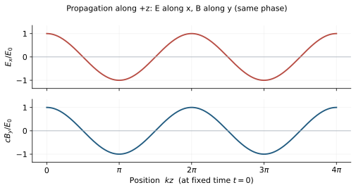

# Chapter 12 — Electromagnetic Waves

Maxwell's last correction made a changing electric field generate magnetic circulation. Faraday's law says a changing magnetic field generates electric circulation. Even with no charges or currents present, these coupled changes can sustain each other and travel through empty space. That travelling disturbance is an **electromagnetic wave**.

## 12.1 Derive the wave equation from Maxwell

In vacuum with $\rho=0$ and $\mathbf J=0$,

```math
\nabla\cdot\mathbf E=0,\quad\nabla\cdot\mathbf B=0,\quad\nabla\times\mathbf E=-\partial_t\mathbf B,\quad\nabla\times\mathbf B=\mu_0\varepsilon_0\partial_t\mathbf E.
```

Take the curl of Faraday's law and insert Ampère–Maxwell:

```math
\nabla\times(\nabla\times\mathbf E)=-\partial_t(\nabla\times\mathbf B)=-\mu_0\varepsilon_0\partial_t^2\mathbf E.
```

Use $\nabla\times(\nabla\times\mathbf E)=\nabla(\nabla\cdot\mathbf E)-\nabla^2\mathbf E$ and $\nabla\cdot\mathbf E=0$:

```math
\boxed{\nabla^2\mathbf E-\mu_0\varepsilon_0\partial_t^2\mathbf E=0}.
```

The same steps with $\mathbf B$ give $\nabla^2\mathbf B-\mu_0\varepsilon_0\partial_t^2\mathbf B=0$. Here $\mu_0$ is vacuum permeability ($\mathrm{H/m}$) and $\varepsilon_0$ is vacuum permittivity ($\mathrm{F/m}$). Comparing with the usual wave equation yields

```math
\boxed{c=\frac1{\sqrt{\mu_0\varepsilon_0}}}.
```

Its measured value agrees with the speed of light in vacuum: Maxwell's equations identify light as an electromagnetic wave. The wave equation follows from the field laws; its sinusoidal solutions are **examples**, not the only possible waveforms.

## 12.2 Plane waves and transversality

For a monochromatic plane wave, let $\mathbf k$ be its wavevector ($\mathrm{rad/m}$), $\omega$ its angular frequency ($\mathrm{rad/s}$), and $\mathbf E_0$ its complex amplitude ($\mathrm{V/m}$). Write a real field as the real part of a complex expression:

```math
\mathbf E(\mathbf r,t)=\mathrm{Re}\!\left[\mathbf E_0e^{i(\mathbf k\cdot\mathbf r-\omega t)}\right],\qquad\omega=c|\mathbf k|.
```

The amplitude $\mathbf E_0$ may itself be complex to describe polarisation. From $\nabla\cdot\mathbf E=0$ and $\nabla\cdot\mathbf B=0$, the plane-wave amplitudes obey $\mathbf k\cdot\mathbf E_0=\mathbf k\cdot\mathbf B_0=0$: both fields are **transverse**. From Faraday's law,

```math
i\mathbf k\times\mathbf E_0=i\omega\mathbf B_0\quad\Longrightarrow\quad\boxed{\mathbf B_0=\frac1\omega\mathbf k\times\mathbf E_0=\frac1c\hat{\mathbf k}\times\mathbf E_0}.
```

Thus $\mathbf E$, $\mathbf B$ and propagation direction are mutually perpendicular, with $B=E/c$ for a vacuum plane wave. They oscillate **in phase**, not a quarter cycle apart. The three-dimensional geometry is often drawn misleadingly; the next figure instead plots their signed components against the *same propagation coordinate*.



*Figure 12.1.* At fixed $t=0$, a wave travels along $+z$ with $\mathbf E\parallel\hat{\mathbf x}$ and $\mathbf B\parallel\hat{\mathbf y}$. Separate component axes avoid pretending the curves occupy the same physical plane.

## 12.3 Polarisation is the transverse motion of $\mathbf E$

Let a wave travel along $+z$ and set phase $\theta=kz-\omega t$ (radians). Its two transverse components can be written $E_x=A\cos\theta$ and $E_y=B\cos(\theta+\delta)$, where $A$ and $B$ are electric-field amplitudes ($\mathrm{V/m}$) and $\delta$ is a relative phase (radians); these amplitude letters are not the magnetic field $\mathbf B$. The relative amplitudes and phase determine the tip traced by the electric vector at a fixed position.

If $\delta=0$ or $\pi$, both components rise and fall together and the vector oscillates along a line (**linear polarisation**). If $A=B$ and $\delta=\pm\pi/2$, its magnitude is constant while the direction rotates (**circular polarisation**). The general case is **elliptical polarisation**. The handedness convention depends on the chosen viewing direction, so it should be stated before using right/left labels.

## 12.4 Energy, momentum and radiation pressure

For a vacuum plane wave, $B=E/c$; its instantaneous electric and magnetic energy densities are equal:

```math
\frac12\varepsilon_0E^2=\frac{B^2}{2\mu_0},\qquad u=\varepsilon_0E^2.
```

The Poynting vector points in the propagation direction:

```math
\mathbf S=\frac{\mathbf E\times\mathbf B}{\mu_0}=cu\,\hat{\mathbf k}.
```

For $E=E_0\cos\theta$, averaging $\cos^2\theta$ over a cycle gives the **intensity**

```math
\boxed{I=\langle|\mathbf S|\rangle=\frac12c\varepsilon_0E_0^2}.
```

Intensity $I$ is power per area ($\mathrm{W/m^2}$); radiation pressure has units of pascals ($\mathrm{Pa}$). Since momentum density is $\mathbf g=\mathbf S/c^2$, a normally incident beam exerts pressure $I/c$ if fully absorbed and $2I/c$ if perfectly reflected, in vacuum and for ideal steady illumination. Light transfers momentum even though photons are not needed to derive this classical result.

## 12.5 Waves in a simple material

In a homogeneous, isotropic, **linear, lossless and nondispersive** medium with no free sources, write $\mathbf D=\varepsilon\mathbf E$ and $\mathbf B=\mu\mathbf H$. The same curl argument gives

```math
\boxed{v=\frac1{\sqrt{\varepsilon\mu}}},\qquad\boxed{n=\frac cv=\sqrt{\varepsilon_r\mu_r}}.
```

The permittivity $\varepsilon$ has units $\mathrm{F/m}$, permeability $\mu$ has $\mathrm{H/m}$, refractive index $n$ is dimensionless, and relative material parameters $\varepsilon_r,\mu_r$ are dimensionless. A plane wave has $\mathbf H=(1/\eta)\hat{\mathbf k}\times\mathbf E$, where $\boxed{\eta=\sqrt{\mu/\varepsilon}}$ is the **wave impedance** in ohms ($\mathrm\Omega$). This is different from the circuit impedance of Chapter 10, although both compare electrical quantities. For nonmagnetic optical media $\mu_r\simeq1$ and usually $n\simeq\sqrt{\varepsilon_r}$ at the relevant frequency—not necessarily the *static* dielectric constant from Chapter 5.

## 12.6 Reflection and transmission from boundary conditions

Consider normal incidence from medium 1 to medium 2 at a flat interface. Tangential $\mathbf E$ and $\mathbf H$ are continuous when no free surface current is present. For incident, reflected and transmitted electric amplitudes $E_i,E_r,E_t$, the reflected wave travels backward, so its $\mathbf H$ reverses sign:

```math
E_i+E_r=E_t,\qquad \frac{E_i-E_r}{\eta_1}=\frac{E_t}{\eta_2}.
```

Solve these two equations for amplitude reflection and transmission coefficients:

```math
\boxed{r\equiv\frac{E_r}{E_i}=\frac{\eta_2-\eta_1}{\eta_2+\eta_1}},\qquad\boxed{t\equiv\frac{E_t}{E_i}=\frac{2\eta_2}{\eta_2+\eta_1}}.
```

Here $r,t$ are dimensionless electric-field amplitude coefficients, not the spatial radius or time variable used in other chapters. For **real positive impedances**, power ratios are $R=|r|^2$ and $T=(\eta_1/\eta_2)|t|^2$, so $R+T=1$. If the media are nonmagnetic, $\eta\propto1/n$ and $r=(n_1-n_2)/(n_1+n_2)$. This is the normal-incidence Fresnel result—not a rule to reuse unchanged at oblique angles or in absorbing materials.

## 12.7 Oblique incidence: reflection and refraction

At an interface, the phase of the field must agree at every point *along* the boundary and at every time. Therefore the tangential wavevector is shared: $k_{1}\sin\theta_i=k_{2}\sin\theta_t$. Since $k_j=n_j\omega/c$,

```math
\boxed{n_1\sin\theta_i=n_2\sin\theta_t}\quad\text{(Snell's law)}.
```

There are two independent polarisations: **s** with $\mathbf E$ perpendicular to the plane of incidence, and **p** with $\mathbf E$ in that plane. Applying the same tangential boundary conditions to each gives the Fresnel coefficients. At a particular incidence angle, the p-polarised reflection can vanish (**Brewster angle**); for nonmagnetic lossless media, $\tan\theta_B=n_2/n_1$. If $n_1>n_2$, angles above $\theta_c=\arcsin(n_2/n_1)$ have no propagating refracted wave (**total internal reflection**), though an evanescent field still exists beyond the interface. Angles $\theta_i,\theta_t,\theta_B,\theta_c$ are measured from the interface normal.

## 12.8 Production of waves and what comes next

Time-dependent charges and currents generate time-dependent fields. Different frequencies belong to the same electromagnetic spectrum—from radio and microwaves through infrared, visible and ultraviolet to X-rays and gamma rays. The names distinguish frequency ranges, not different governing field equations. The vacuum Maxwell equations show that once produced, electromagnetic disturbances propagate even through charge-free space. The details of fields from accelerating charges, retarded potentials, optical dispersion, absorption and guided modes require further electrodynamics. At this stage the essential chain is complete: **charges and currents → Maxwell's equations → waves → energy and momentum transfer**.

---
**Sources.** R. Shankar, *Fundamentals of Physics II: Electromagnetism, Optics, and Quantum Mechanics*, Chapter 14 and §§16.4–16.5;  David Halliday, Robert Resnick and Jearl Walker, *Fundamentals of Physics*, 12th ed., Chapter 33; David J. Griffiths, *Introduction to Electrodynamics*, 5th ed., Chapter 9; Richard P. Feynman, Robert B. Leighton and Matthew Sands, *The Feynman Lectures on Physics, Volume II: Mainly Electromagnetism and Matter*, Chapters 18 and 20 (optional intuition).
